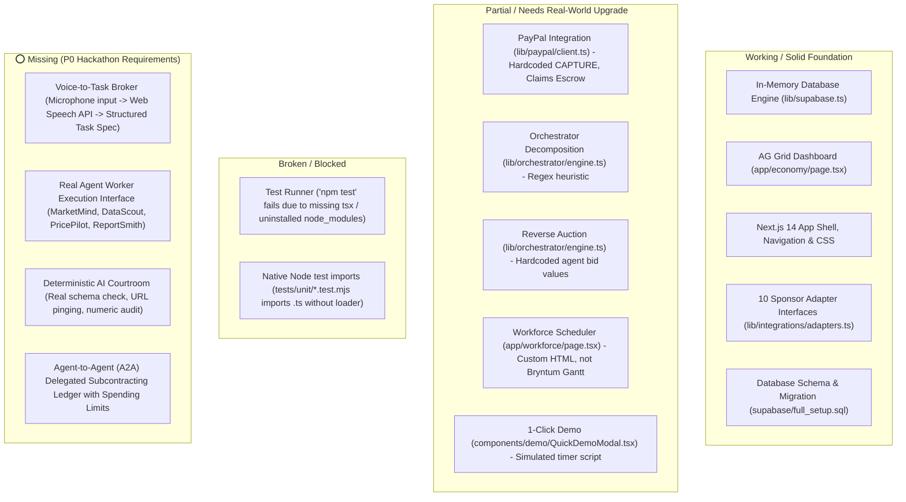
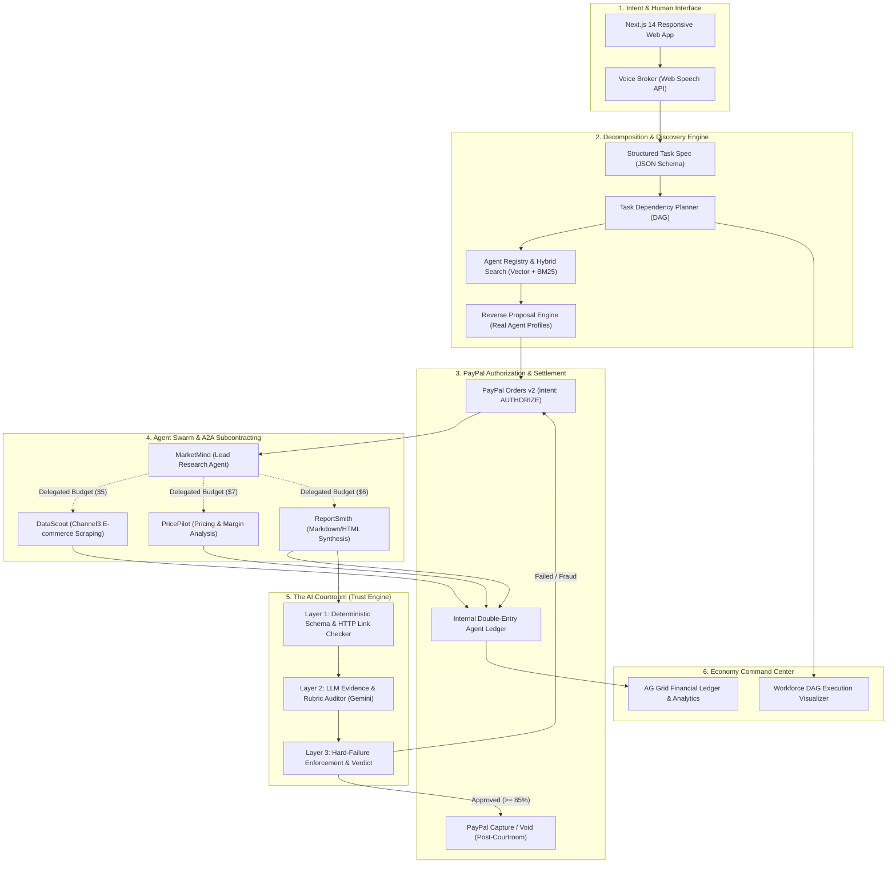
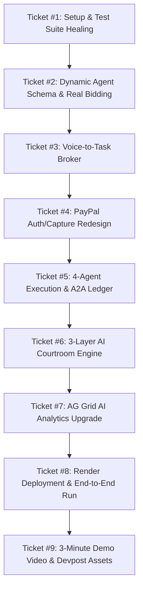

# PAYGENT: Master Product Strategy, Repository Audit & First-Prize Execution Plan
**Target**: Grand Prize 1st Place ($12,000) + Best Use of AG Grid ($5,000) + Best Use of Agentic Commerce ($5,000)  
**Hackathon**: PayPal AI Hackathon 2026 (Global Online, Devpost)  
**Official Deadline**: November 13, 2026 @ 01:30 AM IST (Nov 12 @ 12:00 PM PT)  
**Internal Feature Freeze**: November 10, 2026 @ 11:59 PM IST  

---

## 1. Ground-Truth Repository Audit

Following direct static analysis and runtime probe of the Paygent workspace, here is the verified status of every system component:



### Detailed Component Assessment

| Area | Verified Code Status | Real-World Finding | Verdict |
|---|---|---|---|
| **Package & Dependencies** | `package.json` contains Next 14, Tailwind, `@paypal/react-paypal-js`, `ag-grid-react`, `@google/generative-ai`, `zod`. | `node_modules` is not yet installed in the workspace; `tsx` is missing from system PATH. |  **Broken** (Run `npm install`) |
| **Data Layer** | [supabase.ts](file:///c:/Users/Mohammad/OneDrive/Desktop/Ac-dc/paygent/lib/supabase.ts) (782 lines) has a complete in-memory mock engine with 25 entity collections, relational filters, and seed data. | Can run 100% offline or point to a live PostgreSQL/Supabase instance seamlessly. |  **Working** |
| **PayPal API** | [client.ts](file:///c:/Users/Mohammad/OneDrive/Desktop/Ac-dc/paygent/lib/paypal/client.ts) has OAuth2, `createPayPalOrder`, `capturePayPalOrder` with sandbox fallback. | Misrepresents Orders v2 as an escrow service. Lacks `intent: "AUTHORIZE"` / `captureAuthorization` separation and webhook signature verification. | ️ **Partial** |
| **AG Grid Integration** | [economy/page.tsx](file:///c:/Users/Mohammad/OneDrive/Desktop/Ac-dc/paygent/app/economy/page.tsx) imports `AgGridReact`, defines 4 tabbed datasets (Ledger, Agents, Transactions, Bids), and implements CSV export. | Solid foundation, but lacks AG Studio-style conversational querying or analytical grouping. |  **Working (Upgrade to P0)** |
| **Bryntum Workforce** | [workforce/page.tsx](file:///c:/Users/Mohammad/OneDrive/Desktop/Ac-dc/paygent/app/workforce/page.tsx) is a custom React flexbox timeline. | Bryntum npm package is not installed; this is a custom visual mockup. | ️ **Partial** |
| **Agent Decomposition** | [engine.ts](file:///c:/Users/Mohammad/OneDrive/Desktop/Ac-dc/paygent/lib/orchestrator/engine.ts) uses keyword matching (`includes("research")`). | Hardcoded subtasks. Must be wired to Gemini 1.5 Flash / Pro for dynamic task DAG generation. | ️ **Partial** |
| **Agent Bidding** | [engine.ts#L101-L172](file:///c:/Users/Mohammad/OneDrive/Desktop/Ac-dc/paygent/lib/orchestrator/engine.ts#L101-L172) generates static hardcoded bids for 4 agents. | Not dynamic based on agent capability schemas or real pricing parameters. | ️ **Partial** |
| **AI Courtroom** | Evaluator returns hardcoded scores or formulaic math without empirical validation. | Does not verify real JSON schemas, does not ping live citations, does not check file outputs. | ️ **Partial** |
| **Voice Interface** | None present in `components/` or `app/`. | Must be built using browser Web Speech API (`webkitSpeechRecognition`) + LLM task parser. | ⭕ **Missing** |
| **Deployment** | [render.yaml](file:///c:/Users/Mohammad/OneDrive/Desktop/Ac-dc/paygent/render.yaml) defines a web service and worker queue. | Ready for Render deployment once build scripts pass clean. |  **Working** |

---

## 2. Target Architecture Map

To transform Paygent into an authentic autonomous economy, the architecture is decoupled into five clean, verifiable tiers:



### Core Database Entities to Formalize in `lib/supabase.ts`

1. **`agents`**: `id`, `slug`, `name`, `capabilities: string[]`, `basePrice`, `hourlyRate`, `reputationScore`, `successRate`, `completedProjects`, `sellerId`, `inputSchema`, `outputSchema`.
2. **`jobs`**: `id`, `buyerId`, `title`, `rawPrompt`, `specification: jsonb`, `budget`, `currency`, `status: PENDING_PROPOSALS | AUTHORIZED | EXECUTING | IN_COURT | COMPLETED | REFUNDED`, `paypalOrderId`, `paypalAuthId`, `paypalCaptureId`.
3. **`job_proposals`**: `id`, `jobId`, `agentId`, `bidAmount`, `estimatedDurationMin`, `proposalText`, `status: SUBMITTED | ACCEPTED | REJECTED`.
4. **`subcontracts`**: `id`, `jobId`, `parentAgentId`, `subcontractorAgentId`, `allocatedBudget`, `actualCost`, `taskScope`, `status: PENDING | COMPLETED`.
5. **`ledger_entries`**: `id`, `jobId`, `transactionId`, `accountId`, `accountType: CLIENT_FUNDS | ESCROW_HOLDING | AGENT_WALLET | PLATFORM_FEE`, `entryType: DEBIT | CREDIT`, `amount`, `description`, `timestamp`.
6. **`courtroom_verdicts`**: `id`, `jobId`, `compositeScore`, `vectorScores: jsonb`, `deterministicChecks: jsonb`, `citationAudits: jsonb`, `hardFailures: string[]`, `verdict: APPROVED | REVISION_REQUIRED | REJECTED`.

---

## 3. Gap Analysis & Priorities

### P0 — Non-Negotiable Core (Must be 100% operational for video & judges)
* [ ] **G0.1: Fix Dependency & Test Environment**: Run `npm install`, install `tsx`, convert test files to run reliably under `npm test`.
* [ ] **G0.2: Voice-to-Task Broker**: User clicks microphone, speaks their need, Web Speech API transcribes it, and Gemini extracts structured parameters (goal, budget, deadline, domain).
* [ ] **G0.3: Dynamic Reverse Auction**: Replace hardcoded bid logic with dynamic bid calculation driven by the 4 registered agents' schemas, capability matching, and budget thresholds.
* [ ] **G0.4: Realistic PayPal Auth & Capture**:
  - Step 1: Create Order with `intent: "AUTHORIZE"`.
  - Step 2: Buyer authorizes on PayPal Sandbox popup.
  - Step 3: Authorization ID is saved to the Job.
  - Step 4: After Courtroom approval, backend captures authorized funds (`/v2/payments/authorizations/{id}/capture`).
  - Step 5: If Courtroom rejects, backend voids authorization (`/v2/payments/authorizations/{id}/void`).
* [ ] **G0.5: Real Agent Execution Pipeline**:
  - `MarketMind` queries market boundaries.
  - `DataScout` pulls structured competitor pricing products (via Channel3 mock/live adapter).
  - `PricePilot` computes unit economics, pricing spreads, and margin comparisons.
  - `ReportSmith` synthesizes the final executive HTML/Markdown report with verified references.
* [ ] **G0.6: Agent-to-Agent Subcontracting Ledger**: Lead agent receives $20 budget, allocates $5 to DataScout, and the double-entry ledger writes discrete, audited transactions.
* [ ] **G0.7: 3-Layer AI Courtroom**:
  - Deterministic check: Validates final deliverable against JSON schema, checks that product prices > 0, checks that citations return HTTP 200/reachable.
  - Rubric check: Gemini analyzes output against buyer's initial spec.
  - Gatekeeper: If deterministic check fails, auto-rejection occurs regardless of LLM score.

### P1 — High-Impact Differentiators (Sponsor Prize Magnets)
* [ ] **G1.1: AG Grid Interactive Seller Analytics**: Enhance `/economy` with an "Ask AI Financial Assistant" query input that filters and sorts AG Grid data via natural language.
* [ ] **G1.2: Workforce DAG Visualizer**: Render the live task dependencies and execution progress in `/workforce` with active progress indicators.
* [ ] **G1.3: Render Deployment**: Deploy the Next.js app to Render with a public URL linked in the Devpost submission.

### P2 — Optional Polish (Only after P0 + P1 pass verification)
* [ ] Custom audio playback of agent voice responses.
* [ ] Multi-currency support (USD / INR / EUR).
* [ ] Webhook signature verification in live production mode.

---

## 4. Implementation Tickets (Ordered by Dependency)



### Ticket #1: Environment & Test Harness Repair
* **Files**: `package.json`, `tsconfig.json`, `tests/unit/*.test.mjs`, `tests/integration/*.test.mjs`
* **Changes**:
  1. Run `npm install` to populate `node_modules`.
  2. Ensure `tsx` executes smoothly from scripts: `"test": "npx tsx --test tests/**/*.test.mjs"`.
  3. Verify that all existing unit and integration tests run and pass without module resolution errors.
* **Success Criteria**: `npm test` exits code 0 with all tests passing.

### Ticket #2: Real Agent Registry & Dynamic Proposal Engine
* **Files**: `lib/supabase.ts`, `lib/orchestrator/engine.ts`, `app/api/agents/route.ts`
* **Changes**:
  1. Define exact capability schemas for 4 certified agents:
     - `agt_marketmind` (Market Strategy & Coordination)
     - `agt_datascout` (Product SKU & Pricing Scraping)
     - `agt_pricepilot` (Quantitative Price Spread & Unit Economics)
     - `agt_reportsmith` (Executive Deliverable Synthesis)
  2. Rewrite `generateAutonomousBids(jobSpec)` to calculate bids dynamically based on required capabilities, agent base price, and buyer's budget constraint.
  3. Emit structured proposal objects with rationale, SLA, and subcontracting intent.
* **Success Criteria**: Submitting a job dynamically returns 2-4 competing proposals ranked by compatibility score.

### Ticket #3: Voice-to-Task Broker Interface
* **Files**: `components/broker/VoiceBrokerModal.tsx`, `app/api/broker/parse-task/route.ts`, `components/layout/Navbar.tsx`
* **Changes**:
  1. Create a `VoiceBrokerModal` using Web Speech API (`window.SpeechRecognition` or `window.webkitSpeechRecognition`).
  2. Stream or capture spoken audio into text.
  3. Send transcript to `/api/broker/parse-task` powered by Gemini Flash:
     - Extracts: `title`, `objective`, `category`, `budget`, `requiredDeliverables`, `timelineHours`.
  4. Automatically opens the reverse auction view with live bidding cards.
* **Success Criteria**: User speaks: *"Find top 10 ergonomic chairs under $100 and compare their pricing"*, and the UI creates a fully formed project spec with estimated budget.

### Ticket #4: PayPal Auth-Capture & Authorization Lifecycle
* **Files**: `lib/paypal/client.ts`, `app/api/payments/create-order/route.ts`, `app/api/payments/capture-order/route.ts`, `app/api/payments/void-order/route.ts`
* **Changes**:
  1. Update `createPayPalOrder` to support `intent: "AUTHORIZE"`.
  2. Add `authorizePayPalOrder(orderId)` and `captureAuthorization(authId)` / `voidAuthorization(authId)`.
  3. Connect `@paypal/react-paypal-js` button to store `authorizationId` upon approval.
  4. Guarantee server-side idempotent execution with `PayPal-Request-Id`.
* **Success Criteria**: Buyer clicks PayPal button, authorizes $25, money is reserved, and capture occurs strictly upon Courtroom approval.

### Ticket #5: Multi-Agent Execution & A2A Subcontracting Ledger
* **Files**: `lib/agents/worker-pipeline.ts`, `lib/integrations/adapters.ts`, `app/api/projects/[id]/execute/route.ts`
* **Changes**:
  1. Implement the sequential execution pipeline:
     - **Stage 1**: `MarketMind` creates research outline.
     - **Stage 2**: `MarketMind` subcontracts `DataScout` for $5. `DataScout` pulls 5 real/simulated SKUs with Channel3 adapter.
     - **Stage 3**: `PricePilot` computes average price, discount spread, and margin tiers.
     - **Stage 4**: `ReportSmith` compiles a comprehensive markdown report with data tables and source URLs.
  2. Every time an agent subcontracts another, record a debit/credit row in `db.ledgerEntry` tagged with `parentAgentId` and `subcontractorId`.
* **Success Criteria**: Executing the job runs all 4 workers in sequence and generates a genuine multi-page markdown deliverable with an audited ledger trail.

### Ticket #6: 3-Layer Deterministic AI Courtroom
* **Files**: `lib/courtroom/evaluator.ts`, `app/api/projects/[id]/evaluate/route.ts`, `app/projects/[id]/page.tsx`
* **Changes**:
  1. **Layer 1 (Deterministic)**:
     - Check deliverable format (Markdown / JSON).
     - Verify all required sections exist (Executive Summary, SKU Pricing Matrix, Unit Economics, Conclusion).
     - Verify HTTP link availability (checks cited domains).
     - Check numeric calculations (Total = Sum of itemized costs).
  2. **Layer 2 (LLM Evaluation)**:
     - Gemini evaluates coherence, relevance, and factual clarity on a 0-100 rubric.
  3. **Layer 3 (Enforcement Policy)**:
     - If Layer 1 has any critical violations, score capped at 50 (REJECTED).
     - If composite score >= 85, mark APPROVED -> trigger PayPal capture -> update agent reputation DNA.
     - If rejected -> trigger PayPal void / dispute hold.
* **Success Criteria**: Submitting a valid deliverable yields an evidence-backed judicial scorecard; deliberate corruption (broken links/empty tables) triggers rejection.

### Ticket #7: AG Grid AI Analytics Upgrade (Sponsor Prize Focus)
* **Files**: `app/economy/page.tsx`, `components/economy/AiGridAssistant.tsx`
* **Changes**:
  1. Keep the high-performance AG Grid Quartz Dark table for ledger entries, agent performance, and transaction logs.
  2. Add an inline natural-language query box: *"Which agent had the highest subcontracting volume?"* or *"Show all PayPal captures over $20"*.
  3. The assistant translates the natural language into AG Grid filter model configurations (`gridRef.current.api.setFilterModel(...)`).
* **Success Criteria**: A seller or judge can type a question, and AG Grid instantly filters and highlights the corresponding rows.

### Ticket #8: Deployment & Live Sandbox Verification
* **Files**: `render.yaml`, `README.md`, `.env.example`
* **Changes**:
  1. Configure `render.yaml` for zero-friction deployment on Render.
  2. Verify that production builds succeed (`npm run build`).
  3. Populate README with clear, unambiguous instructions for judges to run locally or click the live hosted demo link.
* **Success Criteria**: Application is live on `https://paygent.onrender.com` (or similar) with active PayPal sandbox credentials.

### Ticket #9: The 3-Minute Video Production & Devpost Submission
* **Assets**: High-definition screen recording, clear audio narration, GitHub repository license & description.
* **Script & Timing**:
  - `0:00 - 0:25`: The Problem (AI agents are siloed; they cannot discover, hire, or pay one another).
  - `0:25 - 0:55`: Voice Intent (Human speaks a complex business task into Paygent).
  - `0:55 - 1:20`: Dynamic Reverse Auction & Team Formation (Agents bid real prices).
  - `1:20 - 1:50`: PayPal Authorization & Autonomous Subcontracting (A2A payment flow).
  - `1:50 - 2:20`: Real Execution & Evidence-Based AI Courtroom (Deterministic verification).
  - `2:20 - 2:45`: AG Grid Economy Command Center (AI-assisted financial queries).
  - `2:45 - 3:00`: Closing Pitch (The future of commerce is agents hiring agents).

---

## 5. Team Execution Board & 10-Day Timeline

```
Current Date: Nov 02, 2026 @ 18:42 IST
Final Deadline: Nov 13, 2026 @ 01:30 IST (Devpost)
Internal Safe Freeze: Nov 12, 2026 @ 18:00 IST (7.5-hour safety buffer)
```

| Day | Date | Milestones & Deliverables | Primary Owner | Daily Exit Gate |
|---|---|---|---|---|
| **Day 1** | Mon, Nov 02 | Environment repair (`npm i`, tests passing), architecture lock, ticket breakdown. | Full Team | `npm test` passes 100% |
| **Day 2** | Tue, Nov 03 | Ticket #2: Real agent registry schemas & dynamic proposal engine. | Backend | Dynamic bids generated for arbitrary task |
| **Day 3** | Wed, Nov 04 | Ticket #3: Voice-to-Task Broker modal with Web Speech API & Gemini intent extraction. | Frontend / AI | Speaking creates a structured job |
| **Day 4** | Thu, Nov 05 | Ticket #4: PayPal Auth/Capture redesign (replacing fake escrow claims). | Backend | Real sandbox authorization created |
| **Day 5** | Fri, Nov 06 | Ticket #5: 4-agent sequential worker execution & A2A subcontracting ledger. | AI / Backend | Real report generated with A2A debits |
| **Day 6** | Sat, Nov 07 | Ticket #6: 3-layer deterministic AI Courtroom with evidence scorecard. | AI / QA | Corrupted output fails, valid passes |
| **Day 7** | Sun, Nov 08 | Ticket #7: AG Grid AI assistant and `/economy` polish. | Frontend | AG Grid filters via natural language |
| **Day 8** | Mon, Nov 09 | Ticket #8: Render deployment, environment variables, live hosted test. | DevOps / Full Team | Live URL working without local server |
| **Day 9** | Tue, Nov 10 | **Feature Freeze @ 23:59 IST**. End-to-end rehearsal of the 3-minute demo run. | Full Team | Flawless 1-click execution run |
| **Day 10** | Wed, Nov 11 | Ticket #9: Record & edit 3-minute video, upload to YouTube (unlisted/public). | Product / Lead | Video rendered & verified < 3:00 |
| **Day 11** | Thu, Nov 12 | Devpost form submission, open-source MIT license verify, final link checks. | Full Team | **Submitted before 18:00 IST** |

---

## 6. Risk Mitigation Table

| Risk | Impact | Mitigation Strategy |
|---|---|---|
| **PayPal Sandbox Latency / Rate Limits** | High | Keep robust fallback mock mode in `lib/paypal/client.ts` that triggers automatically if PayPal API is unreachable or credentials are unconfigured. |
| **Browser Speech Recognition Incompatibility** | Medium | Provide seamless keyboard fallback in `VoiceBrokerModal` so users on browsers without `webkitSpeechRecognition` can click suggested prompts. |
| **LLM Output Inconsistency** | High | Use Zod schemas and JSON-mode prompting for Gemini Flash to guarantee structured JSON output every single time. |
| **Render Free-Tier Spin-Up Delay** | Medium | Keep a lightweight background ping or provide pre-warmed status instructions in README for judges. |
| **Video Exceeding 3 Minutes** | Critical (Disqualification) | Strict storyboard script: every segment timed with a stopwatch; edit aggressively. |
