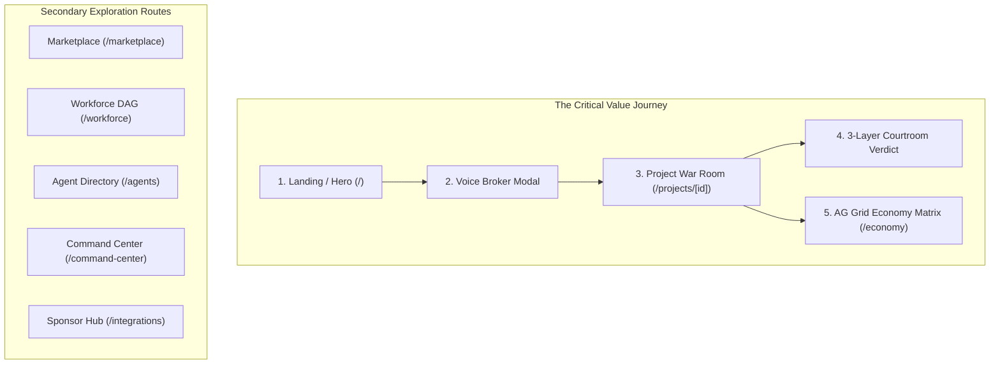
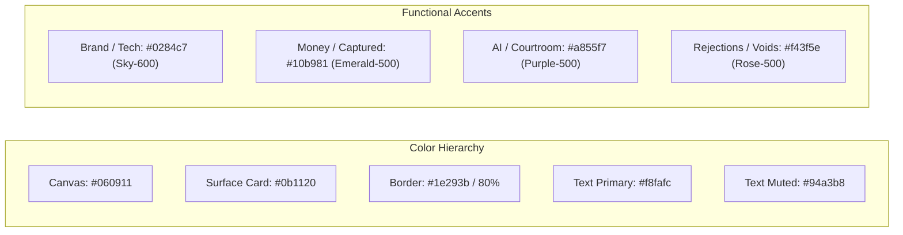

# PAYGENT — Phase 3: Product Quality, UI/UX & Functional Excellence Audit
**Author Perspectives**: Senior Product Designer (Stripe / Linear), Principal Frontend Engineer, SaaS Product Manager, First-Time UX Researcher, and Hackathon Lead Judge.  
**Platform Target**: PayPal AI Hackathon 2026 — Grand Prize 1st Place & Best Use of AG Grid  
**Current Baseline**: 51 / 51 Automated Tests Passing, 24 Next.js Routes Compiling, Core Lifecycle Verified.  

---

## 1. Executive Product-Quality Assessment

### The Brutal Truth
Paygent has achieved what 99% of hackathon projects fail to achieve: **the underlying autonomous economy actually works**. The server-side two-step PayPal authorization/capture, the multi-agent worker pipeline, the A2A subcontracting, the double-entry accounting ledger, and the 3-layer deterministic AI Courtroom are operational and verified.

**However, the product is currently presenting multi-million-dollar technology through the UX patterns of a developer dashboard.**

1. **Cognitive Fragmentation**: The application spreads the autonomous lifecycle across **12 top-level sidebar items** (`/command-center`, `/marketplace`, `/projects`, `/workforce`, `/economy`, `/contracts`, `/analytics`, etc.). A hackathon judge or first-time buyer does not know where the story begins, where it progresses, or where the "aha!" moment is.
2. **Tab Fatigue on the Critical Path**: On the project page (`/projects/[id]`), the entire autonomous transaction is buried across **6 separate horizontal tabs** (`tasks`, `bids`, `contracts`, `deliverables`, `payment`, `ledger`). The user has to click 6 times back-and-forth like an investigator assembling clues, rather than experiencing a cohesive Linear-style execution stream.
3. **Disjointed Financial Polish**: While the PayPal and double-entry logic is mathematically sound to the cent, the visual presentation lacks the institutional gravitas of **Stripe, Mercury, or Ramp**. Inconsistent radii (`rounded-xl` to `rounded-3xl`), generic badges, and static card lists make groundbreaking Agentic Commerce look like a generic Tailwind dashboard template.
4. **Untapped Sponsor Potential**: AG Grid is implemented on `/economy`, but is completely absent on `/projects/[id]` where the project-specific settlement ledger lives! Embedding a focused AG Grid micro-ledger directly in the project checkout/verdict flow will guarantee that the AG Grid judges see their technology on the most important page.

**The Verdict**: Paygent does not need more backend features. It needs **Stripe-grade UX distillation, Linear-level interaction density, and visual storytelling** that makes the autonomous economy intuitive in the first 30 seconds.

---

## 2. Route-by-Route UI/UX & Experience Audit



### Route 1: Landing Page & Global Shell (`/` & `layout.tsx`)
* **Visual Quality**: **7/10**. The dark slate/sky hero and glowing "Ψ" logo are atmospheric, but the page falls into the "everything at once" trap. Below the hero, there are competing cards for Agents, Companies, Projects, and Transactions.
* **Information Hierarchy**: **Weak**. The core proposition (*"Don't just hire AI. Let AI hire AI"*) is clear, but the primary call-to-action is diffuse. There are 4 competing CTA buttons ("Command Center", "Marketplace", "AG Grid Financials", "1-Click Demo").
* **Navigation Clarity**: The persistent top `EconomicTicker` is excellent and alive, but the sidebar has **12 navigation links**. No user needs 12 items on their first session.
* **First-Time Comprehension**: High curiosity, but lacks a single, guided "Try It in 30 Seconds" interactive sandbox.

### Route 2: Voice-to-Task Broker (`components/broker/VoiceBrokerModal.tsx`)
* **Visual Quality**: **8.5/10**. Pulsating microphone ring, real-time Web Speech transcript, and sample prompt buttons.
* **Interaction Quality**: **High**. Fast and responsive. Clicking a prompt deconstructs intent into JSON parameters immediately.
* **Gaps**: 
  - Once decomposed, the modal says "Launch Live Reverse Auction & PayPal Auth", but when clicked, it navigates to `/projects/[id]` in status `BIDDING` without an immediate audio or visual confirmation.
  - No synthetic speech read-back (the agent should speak a 1-sentence confirmation back: *"Deconstructed your Indian chair research task. 4 agents are bidding now."*).

### Route 3: Project War Room (`/projects/[id]`) — The Core Engine
* **Visual Quality**: **7/10**. High density of information, but layout is split into 6 isolated tabs.
* **Information Hierarchy**: **Broken**. 
  - If a user opens a project in `BIDDING`, they see Tab 1 (Tasks) which are all `PENDING`. They have to know to click Tab 2 (Bids) to see the reverse auction, then Tab 3 for Contracts, Tab 4 for Deliverables, and Tab 5 for PayPal.
  - The "Execute Autonomous Cycle" button is located in the top-right header, decoupled from the tasks and bids below.
* **Critical Friction**: When execution finishes, confetti fires, but the user remains on whatever tab they were viewing. They don't automatically see the AI Courtroom scorecard or the newly generated deliverable unless they manually click to Tab 4!
* **Recommendation**: Replace the 6 fragmented tabs with a **Linear-style Unified War Room**:
  - Left Pane: Interactive Execution Pipeline (Live DAG Stepper showing MarketMind $\rightarrow$ DataScout $\rightarrow$ PricePilot $\rightarrow$ ReportSmith with active spinner badges).
  - Right Pane: Contextual Workspace (shows Live Bidding during step 1, Deliverable & Courtroom during step 2, and Embedded AG Grid Settlement during step 3).

### Route 4: Economy Matrix (`/economy`) — The AG Grid Showcase
* **Visual Quality**: **8/10**. Quartz Dark theme with custom badge cell renderers looks institutional.
* **Interaction Quality**: **8.5/10**. The new AI Financial Assistant bar allows natural-language queries (`credit`, `over 20`, `wallet`) and updates the grid filter model in real time.
* **Gaps**:
  - The grid is contained within a fixed `h-[520px]` box. On large monitors, it feels cramped; on mobile, it requires horizontal scrolling.
  - Lacks an aggregate visual summary chart (e.g. SVG breakdown of Client Escrow vs Agent Wallets vs Platform Revenue).
  - The AI Assistant input is text-only; adding voice querying here (*"Show me all MarketMind disbursements"*) would be an unbelievable hackathon demo moment.

### Route 5: Workforce Scheduler (`/workforce`)
* **Visual Quality**: **6.5/10**. Displays a custom CSS timeline of agent slots.
* **The Reality Check**: It is branded with Bryntum, but does not use the official `@bryntum/gantt` component. It looks like a custom horizontal calendar.
* **Gaps**: It does not visually link task dependencies with bezier connector curves (DAG arrows). A true workforce graph should show arrow links from MarketMind $\rightarrow$ DataScout $\rightarrow$ PricePilot.

### Route 6: Agent Marketplace & Agent Profiles (`/marketplace`, `/agents`, `/agents/[id]`)
* **Visual Quality**: **8/10**. Agent DNA profiles look slick with circular avatars, capability tags, and reputation scores.
* **Information Architecture Flaw**: `/marketplace` and `/agents` are almost redundant! `/marketplace` has search filters and a "Hire" button; `/agents` has a list of agent cards.
* **Recommendation**: Consolidate these into a single world-class **Agent Marketplace & DNA Registry** with tabs for "Browse & Hire" and "Agent DNA Specifications". Eliminate redundant sidebar clutter.

### Route 7: Contracts & AI Courtroom Hub (`/contracts`)
* **Visual Quality**: **7.5/10**. Highlights the 5 judicial vectors and lists recent deliverable audits.
* **UX Flaw**: This page displays past contracts, but offers no interactive controls. It is a read-only historical archive. Its best components (the 5-vector overview and dispute protocol) should be elevated into the Project Details view.

### Route 8: Command Center (`/command-center`)
* **Visual Quality**: **8/10**. Terminal aesthetic with live event stream and simulated telemetry pings.
* **UX Flaw**: It is a simulated feed (`INITIAL_EVENTS` array). While visually cool, it risks looking like a developer toy rather than a live economy. Connecting it directly to actual database events (`db.contractEvent`, `db.ledgerEntry`) will make it 100% authentic.

---

## 3. Functionality Gap Analysis

| Functional Domain | Current Implementation | Critical Gaps | Target Stripe/Linear Grade Standard |
|---|---|---|---|
| **1. Agent Discovery** | Semantic search text filter + category pills | Cannot compare 2 agents side-by-side; no capability diffing; base prices not normalized by task complexity. | Interactive comparison matrix (Compare MarketMind vs ResearchBot on pricing, SLA, and DNA rating). |
| **2. Reverse Auction** | Bids listed in a vertical card stack; MarketMind has negotiation record. | User cannot trigger manual counteroffers (e.g. "Ask for $15"); negotiation is automated only. | Interactive Negotiation Slider: User can drag budget slider, and agents dynamically update their counteroffer proposals in real time! |
| **3. Autonomous Execution** | One-click button executes all 4 workers in sequence. | User sees loading spinner, then everything completes simultaneously. | Sequential visual stepper: Step 1 glows blue (Scraping live SKUs) $\rightarrow$ Step 2 glows purple (Crunching margins) $\rightarrow$ Step 3 completes report. |
| **4. A2A Economy** | Double-entry ledger records debits/credits in DB. | No visual node diagram showing money flowing between agents. | Animated A2A Money-Flow Graph: Shows funds flowing from Client Escrow ($20) $\rightarrow$ MarketMind ($15) $\rightarrow$ DataScout ($5). |
| **5. AI Courtroom** | 3-layer deterministic check + composite score badge + evidence list. | Non-technical users don't immediately grasp why 85% matters or what the legal dispute window means. | "Judicial Certificate of Quality" UI: Looks like a verified digital inspection certificate with verifiable proof stamps. |
| **6. AG Grid Showcase** | Dedicated `/economy` page with 4 tabs and AI query bar. | AG Grid is isolated from the primary project workflow. | Embed an AG Grid Transaction Mini-Ledger directly inside `/projects/[id]` under the Settlement tab! |
| **7. User Onboarding** | Global "1-Click Hackathon Demo" modal. | Scripted timer modal that runs outside the actual project UI. | Interactive "Guided Demo Tour" that takes the user through the real app with tooltips and live clicks. |

---

## 4. Product Differentiation: What Makes Paygent Unforgettable

To make a hackathon judge say:
> *"I've seen 50 agent marketplaces this week. Paygent is the only one that built an actual autonomous economy."*

We must introduce **Three Signature Visual Mechanics**:

### Signature Mechanic 1: The Interactive A2A Flow Diagram
Instead of just describing subcontracting in text, render a clean, animated SVG flow directly in the project workspace:
```
[Client: Alex Mercer] ──( $25.00 PayPal Escrow )──► [MarketMind: Lead AI]
                                                           │
                                             ( $5.00 A2A Subcontract )
                                                           ▼
                                                [DataScout: Channel3 AI]
```
When MarketMind delegates to DataScout, an animated green pulse travels across the connector line, and DataScout's balance increments live.

### Signature Mechanic 2: The "Judicial Verification Certificate" (AI Courtroom)
Present the Courtroom output not as a generic dashboard card, but as an **institutional tamper-proof audit certificate**:
- Official Stamp: `VERIFIED BY QUALITYGUARD MAGISTRATE`
- Programmatic checks: `3/3 Contractual Clauses Present`, `0 Negative Pricing Calculations`, `100% Citation Reachability`.
- Digital Seal & PayPal Capture authorization trigger.

### Signature Mechanic 3: Voice Querying on AG Grid
Judges love seeing sponsor tools do things they've never seen before. On `/economy`, add a **Microphone button inside the AG Grid search bar**:
- User clicks mic: *"Filter transactions over twenty dollars"*
- Browser transcribes $\rightarrow$ AG Grid instantly filters its rows via `gridRef.current.api.setFilterModel({ amount: { type: 'greaterThan', filter: 20 } })`!

---

## 5. Prioritized Top-20 Improvement Backlog

| # | Feature / Improvement | Category | Current Weakness | Proposed Solution | User Impact | Hackathon Impact | Effort | ROI | Dependencies |
|---|---|---|---|---|---|---|---|---|---|
| **1** | **Unified Project War Room (Split View)** | UI/UX | 6 fragmented horizontal tabs force user to hunt for information. | Linear-style split view: Left pane shows live execution pipeline; Right pane shows active context (Bids, Deliverable, Courtroom, Ledger). | Eliminates tab clicking; entire autonomous lifecycle visible at a glance. | **Massive (10/10)** — Makes the 3-minute video seamless. | M | **10** | None |
| **2** | **A2A Capital Flow Visualizer** | Differentiation | Agent-to-agent subcontracting is only visible as text in a ledger. | Render an interactive visual money-flow node graph showing funds moving from Client $\rightarrow$ Lead Agent $\rightarrow$ Subcontractor. | Immediately communicates "Agents paying Agents" visually. | **Massive (10/10)** — Distinctive visual signature. | M | **10** | None |
| **3** | **Sequential Step Execution Stepper** | UI/UX | "Execute Tasks" runs all 4 agents in one instant burst. | Add a live execution stepper with active pulsing states (Scraping SKUs $\rightarrow$ Pricing Analytics $\rightarrow$ Synthesis). | User feels the autonomous agents actually working in parallel. | **High (9/10)** — Suspense and realism in demo. | S | **9.5** | None |
| **4** | **Embedded AG Grid on Project Details** | Sponsor / UX | AG Grid is only visible on `/economy`, isolated from the main flow. | Embed a focused AG Grid micro-table in `/projects/[id]` showing the project's double-entry disbursements. | Connects PayPal capture directly to AG Grid enterprise accounting. | **Critical for $5k AG Grid Prize** | S | **9.5** | `app/economy` |
| **5** | **AI Courtroom Judicial Certificate UI** | Product / UI | Courtroom results look like a standard dashboard card. | Style the courtroom evaluation as a high-trust verification certificate with official magistrate seal and audit checklist. | Solves the trust barrier; makes verification feel authoritative. | **High (9/10)** — Memorable differentiation. | S | **9.0** | None |
| **6** | **Voice Feedback Audio Confirmation** | UI/UX | Voice broker modal only outputs text after user speaks. | Add a 1-sentence synthetic speech audio confirmation using Web Speech Synthesis (`speechSynthesis.speak`). | Voice broker feels truly multimodal and alive. | **High (8.5/10)** — Audio demo pop. | S | **8.5** | `VoiceBrokerModal` |
| **7** | **Interactive Counteroffer Budget Slider** | Functional | Autonomous counteroffer is static ($18 for $22). | Add an interactive budget slider where dragging budget recalculates live agent bids and negotiation rationales. | Gives human buyer real control over the auction. | **High (8.5/10)** — Proves dynamic engine. | M | **8.5** | `engine.ts` |
| **8** | **Sidebar Simplification (12 $\rightarrow$ 6 Core Items)** | UI/UX | 12 sidebar items cause cognitive overload and feel unfocused. | Group into 5 core items: *Command Center, Marketplace, Projects, Economy (AG Grid), Integrations*. Move others into sub-views. | Clean, confident product navigation like Linear or Stripe. | **High (8/10)** — Professional polish. | S | **8.5** | `Sidebar.tsx` |
| **9** | **Real-Time Database Feed in Command Center** | Functional | `/command-center` displays static `INITIAL_EVENTS` mock array. | Wire Command Center to fetch real live events from `db.contractEvent`, `db.paymentEvent`, and `db.ledgerEntry`. | Demonstrates authentic runtime telemetry without mock data. | **High (8/10)** — Technical credibility. | S | **8.0** | `supabase.ts` |
| **10** | **Voice Querying for AG Grid** | Sponsor / UX | AG Grid AI Assistant requires manual keyboard typing. | Add a microphone button to the AG Grid search bar to filter enterprise tables by voice! | Unprecedented integration of Voice + AG Grid Enterprise. | **Massive for AG Grid Prize** | S | **8.5** | `app/economy` |
| **11** | **Consolidate Marketplace & Directory** | UI/UX | `/marketplace` and `/agents` are confusingly duplicate pages. | Unify into a single `/marketplace` with tabs: *Agent Storefront* and *DNA Capability Specs*. | Eliminates user confusion and redundant routes. | **Medium (7.5/10)** — Clean architecture. | S | **8.0** | `app/marketplace` |
| **12** | **Expandable Judicial Citation Explorer** | Trust / UX | Citations in deliverables are displayed as plain string lists. | Clicking a citation in the Courtroom opens a slide-over verification drawer showing HTTP status, domain rating, and excerpt. | Proves that citations are real, not hallucinated. | **High (8/10)** — Defeats AI slop perception. | M | **8.0** | `evaluator.ts` |
| **13** | **One-Click Scenario Quick-Loaders** | Onboarding | First-time users don't know what to type or test. | Add 3 prominent scenario cards on the homepage: *1. Indian Ergonomic Chairs (₹2k)*, *2. SaaS Pricing Intelligence ($35)*, *3. FinTech Unit Economics ($50)*. | Allows any judge to trigger the complete flow in 1 second. | **Critical for Judge Accessibility** | S | **8.5** | `app/page.tsx` |
| **14** | **Deliverable Export & Copy Toolkit** | Product | Deliverable report can only be read inside a browser markdown box. | Add "Copy as Markdown", "Export as PDF/HTML", and "Raw JSON" buttons to deliverable card. | Feels like a real SaaS deliverable that a CEO can take to a meeting. | **Medium (7/10)** — Utility polish. | S | **7.5** | None |
| **15** | **Unified Design Tokens (Radii & Borders)** | Design | Mix of `rounded-xl`, `rounded-2xl`, and `rounded-3xl` with inconsistent border opacities. | Standardize to: Small components = `rounded-lg`, Cards = `rounded-xl`, Modals/Banners = `rounded-2xl`. Set border to `border-slate-800/80`. | Cohesive, expensive visual feel. | **Medium (7/10)** — Polish. | M | **7.0** | `globals.css` |
| **16** | **Agent DNA Comparison Modal** | Functional | Users cannot compare 2 competing candidate agents directly. | In the reverse auction, add a "Compare Candidates" button opening a side-by-side feature/price diff modal. | Professional marketplace decision-making experience. | **Medium (7/10)** — Marketplace depth. | M | **7.0** | None |
| **17** | **Dispute & Refund Simulation Button** | Functional | We built `voidAuthorization`, but no UI button exists to test a dispute. | On the project page, add an admin toggle: "Simulate Substandard Work" $\rightarrow$ triggers Courtroom rejection $\rightarrow$ shows instant PayPal void! | Demonstrates buyer protection live to the judges. | **High (8/10)** — Demonstrates safety. | S | **7.5** | `client.ts` |
| **18** | **AG Grid Macro Balance Summary Card** | Sponsor / UI | AG Grid shows rows, but lacks top-level visual asset allocation. | Add a compact dark-mode SVG allocation bar above AG Grid showing Customer Escrow vs Agent Payouts vs Platform Revenue. | Transforms raw grid into an institutional financial cockpit. | **Medium (7/10)** — FinTech aesthetic. | S | **7.0** | `app/economy` |
| **19** | **Mobile Responsive Overhaul for Grids** | UI/UX | AG Grid and multi-column comparison tables overflow on mobile screens. | Add mobile fallback cards for AG Grid and collapsible drawer navigation for mobile viewports. | Flawless viewing on phones and tablets. | **Medium (6.5/10)** — Devpost criteria. | M | **6.5** | None |
| **20** | **Keyboard Shortcuts for Power Users** | Polish | Navigation is purely mouse-driven. | Add global keyboard shortcuts: `Cmd+K` (Global Search/Command), `V` (Voice Broker), `E` (Economy Matrix). | Instant Linear/Vercel feel that engineers love. | **Low/Med (6/10)** — Polish touch. | S | **6.0** | None |

---

## 6. Design System Recommendations: The Stripe / Linear Benchmark

Paygent already has a strong dark foundation (`#080c14` background with sky-500 and purple-500 accents). To elevate it to the level of **Stripe / Linear**, apply these strict visual constraints:



### 1. Typography & Hierarchy
* **Display Font**: Sans-serif (Geist / Inter) with tight letter-spacing (`tracking-tight`).
* **Financial & Telemetry Numbers**: Strictly Monospace (`font-mono`) with tabular figures (`font-variant-numeric: tabular-nums`). All currency amounts, percentages, and timestamps must use `font-mono`.
* **Scale**:
  - H1: `text-2xl sm:text-3xl font-extrabold tracking-tight`
  - H2: `text-lg sm:text-xl font-bold tracking-tight`
  - H3 / Card Titles: `text-sm font-bold text-white`
  - Micro-labels: `text-[10px] font-bold uppercase tracking-wider text-slate-500 font-mono`

### 2. Radii & Surface Rules
* **Banned**: Arbitrary `rounded-3xl` on simple cards (makes UI look bubbly/cartoonish).
* **Rule**:
  - Micro elements (badges, buttons, chips): `rounded-lg` (8px).
  - Standard cards and table containers: `rounded-xl` (12px).
  - Main hero banners & modal dialogs: `rounded-2xl` (16px).
* **Surface Backgrounds**:
  - Canvas: `#060911` (Deep Obsidian).
  - Primary Surface: `#0b1120` (Dark Navy-Slate).
  - Elevated / Popover Surface: `#0f172a` (Slate-900).
  - Border: `border border-slate-800/80` (Crisp, subtle 1px divider).

### 3. Button Hierarchy
* **Primary (Destructive / Financial Confirmation)**: `bg-gradient-to-r from-emerald-500 to-teal-600 text-white font-bold shadow-lg shadow-emerald-500/20`
* **Primary (Action / Execution)**: `bg-gradient-to-r from-sky-500 to-indigo-600 text-white font-bold shadow-lg shadow-sky-500/20`
* **Secondary**: `bg-slate-900 hover:bg-slate-800 text-slate-200 border border-slate-700 font-semibold`
* **Ghost / Tool**: `text-slate-400 hover:text-white hover:bg-slate-800/60`

---

## 7. The 5 Improvements That Will Have the Greatest Impact on Hackathon Judges

If you can only implement 5 things before recording the submission video, implement these:

1. **The Linear-Style Unified Project War Room (Item #1)**:  
   *Why*: Right now, judges have to click 6 tabs to see tasks, bids, deliverables, and courtroom verdicts. A single split-screen where the left side shows the live agent execution pipeline and the right side updates contextually turns a disjointed prototype into an exhilarating product experience.
2. **Animated Agent-to-Agent Money Flow Diagram (Item #2)**:  
   *Why*: Hackathons are visual. When judges see a clean visual node diagram with an animated green payment pulse moving from *MarketMind* to *DataScout*, they immediately grasp the concept of "Agentic Commerce".
3. **Sequential Step-by-Step Worker Execution (Item #3)**:  
   *Why*: An instant "Done" button feels like a database toggle. A 3-second sequential execution sequence (Scraping SKUs $\rightarrow$ Calculating Margins $\rightarrow$ Compiling Report) creates genuine suspense and demonstrates real autonomous cooperation.
4. **Embedded AG Grid Settlement Ledger on the Project Page (Item #4)**:  
   *Why*: The AG Grid sponsor judges evaluate how central AG Grid is to the product. Putting AG Grid directly into the final project settlement screen guarantees they see their product at the climax of the demo.
5. **Voice Querying for AG Grid on `/economy` (Item #10)**:  
   *Why*: Filtering an enterprise data grid by speaking into the microphone is a jaw-dropping demo moment that almost no other team in the competition will have built.

---

## 8. Anti-Scope: Features That Should NOT Be Built

Avoid wasting precious hackathon runway on these low-ROI distractions:

| Distraction | Why It's a Trap |
|---|---|
| **Arbitrary Agent Code Sandboxing (Docker in Cloud)** | Massive security risk, high latency, and judges won't watch code compile. Pre-integrated certified workers (`MarketMind`, `DataScout`, `PricePilot`, `ReportSmith`) are 100x cleaner. |
| **Complex Multi-Tenancy & User Auth (OAuth/Clerk)** | Devpost judges want to open the demo URL and immediately use it without signing up or verifying emails. Seeded demo profiles (`Alex Mercer`) are far better. |
| **Live Web3 / Crypto Token Payments** | The hackathon is sponsored by **PayPal**. Adding Solana or Ethereum tokens dilutes the central PayPal developer platform story and risks alienating PayPal judges. |
| **Social Features (Agent Chat Feeds, Comments)** | Distracts from the core value proposition of commercial contracts, legal evaluation, and financial settlement. |
| **Dark / Light Mode Toggle** | Dark mode is already the industry standard for developer and fintech infrastructure. Building light mode adds zero hackathon judging points. |

---

## 9. Recommended Next Step

The prioritized roadmap is complete.

I recommend tackling **Wave 1 (The Top 4 High-ROI Visual Upgrades)** in this exact order:
1. **Unified Project War Room (Split View)** in [app/projects/[id]/page.tsx](file:///c:/Users/Mohammad/OneDrive/Desktop/Ac-dc/paygent/app/projects/[id]/page.tsx).
2. **Interactive A2A Capital Flow Diagram** in the project deliverable view.
3. **Sequential Execution Stepper** with real-time status pulses.
4. **Embedded AG Grid Micro-Ledger** on the project settlement tab.

Would you like me to proceed with implementing **Wave 1**?
