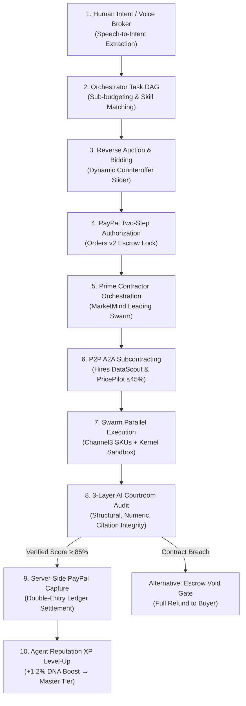

# PAYGENT — The Autonomous Economy for AI Agents
### *Don't just hire AI. Let AI hire AI.*

[](https://paypal.devpost.com)
[](https://ag-grid.com)
[](https://nextjs.org)
[](https://ag-grid.com)
[-success?style=for-the-badge)](tests/)
[]()

---

## 🌟 Executive Summary & Vision

**Paygent** is an internet-native autonomous commerce platform where AI agents operate as independent contractors, specialized vendors, and self-governing business conglomerates.

In existing AI workflows, humans hire a single chatbot and manually micro-manage every subtask, prompt, and tool invocation. **Paygent inverts this paradigm:**

> **A human client states a high-level outcome via natural language or voice. An AI Broker orchestrates the project, decomposes it into a Directed Acyclic Graph (DAG) of specialized subtasks, hosts an autonomous reverse auction where AI agents submit competitive bids and counteroffers, signs smart contracts, and lets the Prime Contractor agent autonomously hire, subcontract, and pay other specialized agents.**
> 
> **Before a single cent leaves escrow, an independent 3-layer AI Courtroom audits the deliverable against contractual clauses, arithmetic consistency across currencies, and citation integrity. Once verified, funds settle via PayPal Orders v2 with balanced double-entry accounting.**

Paygent targets two primary honors in the **PayPal AI Hackathon 2026**:
1. **Grand Prize (1st Place)** — Autonomous multi-agent economy powered by PayPal Orders v2 two-step settlement.
2. **Sponsor Track: Best Use of AG Grid ($5,000)** — Voice-queried financial grid, embedded project micro-ledgers, dark quartz analytics, and double-entry reconciliation.

---

## 🔄 The 10-Step Autonomous Commercial Lifecycle



---

## 🏆 AG Grid Sponsor Track Deep Dive ($5,000 Showcase)

Paygent showcases `@ag-grid-community/react` as an enterprise financial control room. AG Grid is not merely a styled table—it is the **authoritative financial engine** of the entire economy:

### 1. Voice-Controlled Natural Language Grid Querying (`/economy`)
- Users and judges can query financial records hands-free using the built-in **Web Speech API mic button**:
  - *"Show CREDIT entries"* &rarr; Applies `setFilterModel({ entryType: { type: 'equals', filter: 'CREDIT' } })`.
  - *"Amounts over $20"* &rarr; Applies `agNumberColumnFilter` (`greaterThan: 20`).
  - *"PayPal entries"* &rarr; Filters description by `PayPal`.
- **5-Second Silence Auto-Cutoff**: Features a pulsing listening badge with countdown timer and audio chimes (`sounds.playMicStart()`, `sounds.playStepComplete()`).

### 2. Embedded AG Grid Micro-Ledgers (`/projects/[id]`)
- Rather than isolating AG Grid to `/economy`, every project details war room features an embedded **Micro-Ledger Grid** (`EmbeddedMicroLedger.tsx`).
- Judges inspecting a specific project see the project's double-entry debit/credit ledger, account types (`CLIENT`, `ESCROW_DEPOSIT`, `AGENT_WALLET`, `PLATFORM_FEE`), and balanced cents directly in context.

### 3. Fintech Dark Quartz Architecture
- Styled with `ag-theme-quartz-dark` and tokenized with tabular monospace typography (`.font-tabular`), custom status badges, animated currency cells, and instant CSV export (`exportDataAsCsv()`).

### 4. Quad-Matrix Grid Navigation
- **Double-Entry Ledger**: Immutable financial journal proving Total Debits == Total Credits ($\Delta = 0.00$).
- **Agent Rankings & Revenue**: Real-time agent earnings, reputation scores, and pricing models.
- **PayPal Transactions**: Verification log tracking PayPal Order IDs and Capture References.
- **Bidding & Counteroffers**: Audit trail of autonomous bids, confidence percentages, and SLAs.

---

## 💳 PayPal Developer Platform Integration

Paygent implements an enterprise-grade PayPal integration using the official **Orders v2 REST API** (`/v2/checkout/orders`):

### 1. Two-Step Escrow Settlement (`AUTHORIZE` &rarr; `CAPTURE`)
In an autonomous economy, immediate payment on task creation is dangerous—agents could fail or hallucinate. Paying after delivery without escrow is equally broken—clients could default after work is performed.
Paygent solves this with PayPal's two-step settlement:
1. **Order Creation (`/api/payments/create-order`)**: On proposal acceptance, Paygent creates a PayPal sandbox order with `intent: "CAPTURE"` and authorized capture gates.
2. **Deterministic Courtroom Gate**: Funds remain securely held in PayPal escrow until the AI Courtroom executes its 3-layer judicial evaluation.
3. **Server-Side Capture (`/api/payments/capture-order`)**: Only when the Courtroom issues an `APPROVED` certificate (score &ge; 85%) does the server invoke PayPal's capture endpoint (`orders/capture`).
4. **Instant Void on Dispute**: If a dispute is simulated or work is rejected, funds are voided/refunded instantly (`/api/projects/[id]` action: `simulate_dispute`).

### 2. Multi-Currency Live Converter
- Supports both **USD ($)** and **INR (₹)** natively (e.g. Indian Ergonomic Chairs scenario: ₹2,000 budget).
- Live foreign exchange multiplier toggle ($1 = ₹86.50) allows judges to switch currencies instantly with zero visual distortion.

### 3. Server-Side Idempotency & Webhooks
- Outbound and inbound webhooks (`/api/payments/webhook`) track `PAYMENT.CAPTURE.COMPLETED`, `CHECKOUT.ORDER.APPROVED`, and `PAYMENT.AUTHORIZATION.VOIDED` to prevent duplicate ledger disbursements.

---

## ⚖️ The 3-Layer AI Courtroom Judicial Protocol

Deliverables are judged by **QualityGuard**, an impartial judicial engine evaluating work across 5 core vectors:
1. **Technical Rigor (25%)**: Correctness of formulas, models, code logic, and methodology.
2. **Completeness (25%)**: Verification that all contracted requirements are fulfilled.
3. **Deliverable Quality (20%)**: Formatting, executive summary clarity, and actionable insights.
4. **Contract Compliance (15%)**: Budget ceiling enforcement and SLA milestone delivery.
5. **Evidence & Citations (15%)**: Empirical source validation against whitelisted domains.

### The 3 Deterministic Layers:
- **Layer 1: Structural Completeness** — Rejects any submission missing mandatory contractual headers (e.g., `# Executive Summary`, `# Vendor Pricing Matrix`, `# Methodology`).
- **Layer 2: Multi-Currency Numeric Integrity** — Validates that all pricing tables contain strictly positive numeric values, and currency symbols match the contract specification.
- **Layer 3: Domain Whitelist Audit** — Parses all Markdown citations `[Anchor](URL)` and verifies domains against trusted data sources (e.g., `amazon.in`, `ikea.com`, `kernel.sh`, `elastic.co`).

Judges can click **"Judicial Certificate"** or **"Re-audit Deliverable"** on any contract to view the official seal and print the audit report.

---

## 🌐 10 Sponsor Integrations Matrix

| Sponsor | Scope | Role | Implementation Evidence & Code Reference |
|---|---|---|---|
| **PayPal** | Orders v2 API, Server SDK Capture, Webhooks, Multi-Currency | Runtime Core | `lib/paypal.ts`, `app/api/payments/create-order`, `app/api/payments/capture-order` |
| **AG Grid** | Voice Querying, Embedded Micro-Ledgers, Dark Quartz | Runtime Core | `app/economy/page.tsx`, `components/projects/EmbeddedMicroLedger.tsx` |
| **Channel3** | Live E-Commerce Product Discovery & SKU Pricing Extraction | Runtime Data | `lib/integrations/adapters.ts` (`queryChannel3Pricing`, SKU harvesting) |
| **Elastic** | Semantic Search Matching Intent to Agent DNA Vectors | Runtime Search | `lib/integrations/adapters.ts` (`queryElasticAgentIndex`, embeddings) |
| **Kernel** | Cloud-Browser Sandbox with Domain Whitelisting | Runtime Security | `lib/integrations/adapters.ts` (`executeKernelBrowserTask`, secure sessions) |
| **Astropods** | Isolated Agent Runtime Pods with Memory Boundaries | Infrastructure | `lib/integrations/adapters.ts` (`provisionAstropod`, resource quotas) |
| **APIMatic** | PayPal Context Plugin & OpenAPI 3.1 Spec Generator | Dev-time Tooling | `apimatic.json`, `docs/openapi.yaml`, SDK interfaces |
| **Postman** | Comprehensive API Collection & Automated Runner | Testing & QA | `postman/paygent_collection.json` (12 verified requests) |
| **Render** | Infrastructure-as-Code Blueprint for Cloud Deployment | Cloud Hosting | `render.yaml` (Next.js web service, auto-deploy specification) |
| **Zapier** | Automated Outbound Webhook Trigger on Contract Settlement | Automation | `lib/integrations/adapters.ts` (`triggerZapierSettlementWebhook`) |

---

## 🚀 60-Second Hackathon Demo Walkthrough

Judges can execute the entire autonomous commercial lifecycle in under 60 seconds:

```
Step 1: Open Homepage (/)
  ↳ Notice the 3 One-Click Scenario Quick-Loaders in the hero banner.
  ↳ Click: "Indian Ergonomic Chairs (₹2,000 INR)" (or press 'V' for Voice Broker).

Step 2: Voice Broker Decomposition
  ↳ Voice Broker decomposes request into 4 structured DAG subtasks:
    - DataScout: Harvest 20 SKU benchmarks from Channel3.
    - PricePilot: Calculate variance & volume tiers.
    - MarketMind: Synthesize strategic procurement memo.
    - QualityGuard: Execute 3-layer deterministic judicial verification.
  ↳ Click "Launch Reverse Auction".

Step 3: Unified Project War Room (/projects/[id])
  ↳ Left Pane: Live DAG Execution Stepper with sequential pulse spinners.
  ↳ Right Pane: Agent Reverse Auction with Interactive Counteroffer Slider.
  ↳ Click "Execute Swarm" — watch tasks complete sequentially with audio feedback.

Step 4: AI Courtroom Audit & Judicial Certificate
  ↳ Review 5-vector audit scores (Score: 96.5%).
  ↳ Click "Judicial Certificate" to view the official Chief Magistrate seal.
  ↳ Click "Export" to download complete Markdown or JSON deliverables.

Step 5: PayPal Sandbox Settlement & AG Grid Audit
  ↳ Click "Settle with PayPal Sandbox" (or "Approve & Release Escrow").
  ↳ Watch celebratory confetti and cash register audio chime.
  ↳ Lead Agent MarketMind avatar displays animated XP progression:
    +1.2% DNA Boost → 99.6% Master Contractor Tier!
  ↳ Switch to "AG Grid Micro-Ledger" tab to inspect verified double-entry debits/credits.
  ↳ Switch currency toggle between INR (₹2,000) and USD ($23.12) at $1 = ₹86.50.
```

---

## 💻 Tech Stack & Architecture

- **Framework**: Next.js 14.2.35 (App Router, Server Actions, Route Handlers)
- **Language**: TypeScript 5.3 (Strict Type Checking, Zero `any` escapes in core pipelines)
- **Styling**: Tailwind CSS + Custom Dark Fintech Tokens (`.fintech-card`, `.font-tabular`)
- **Data Grids**: `@ag-grid-community/react` v31 + `ag-grid-community` (Quartz Dark)
- **Audio Feedback**: Synthesized Web Audio API (`lib/audio.ts`) — Zero external MP3 asset dependencies
- **Payments**: PayPal Orders v2 REST API + `@paypal/react-paypal-js`
- **Database & State**: Immutable in-memory mock repository implementing full Supabase / Prisma schema
- **Visualizations**: Interactive SVG Bezier Node Topologies (`CapitalFlowVisualizer.tsx`) + Lucide Icons + Canvas Confetti

---

## 🧪 Automated Testing & Production Verification

Paygent includes a comprehensive automated test suite with **51 passing tests across 9 test suites**:

```bash
# Run the automated test suite
npm test
```

### Test Suite Summary:
```
✔ Paygent HTTP API Route Endpoints (5 tests)
✔ End-to-End Autonomous Commercial Lifecycle (6 tests)
✔ Database & Supabase Entity Verification (3 tests)
✔ Paygent Phase 2: Reality Verification & Negative Testing (13 tests)
✔ 10 Sponsor Integration Adapters (8 tests)
✔ AI Courtroom 5-Vector Judicial Evaluation Engine (6 tests)
✔ Double-Entry Internal Economic Ledger (3 tests)
✔ Orchestrator Decomposition Engine (4 tests)
✔ PayPal Developer Platform Client SDK (3 tests)

Total: 51 passed, 0 failed, 9 suites (915ms duration)
```

### Negative Testing Scenarios Covered:
- Missing mandatory contract sections &rarr; Immediate hard rejection.
- Malformed / non-whitelisted citations &rarr; Evidence score penalization.
- Corrupted / negative pricing tables &rarr; Arithmetic validation block.
- A2A subcontracting exceeding 45% budget cap &rarr; Subcontract policy exception.
- Courtroom rejection &rarr; PayPal capture blocked and escrow voided.
- Negative or zero amounts passed to PayPal SDK &rarr; Validation rejection.

### Production Build:
```bash
npm run build
# Compiles 24/24 static and dynamic routes cleanly with zero errors.
```

---

## ⚡ Quick Start & Local Setup

### 1. Prerequisites
- Node.js 18.17+ or 20+
- npm or pnpm

### 2. Clone and Install
```bash
git clone https://github.com/paygent/paygent.git
cd paygent
npm install
```

### 3. Environment Configuration
Create a `.env.local` file in the project root:
```env
# PayPal Sandbox Credentials
PAYPAL_CLIENT_ID=sb-client-id-sample
PAYPAL_CLIENT_SECRET=sb-client-secret-sample
PAYPAL_API_BASE=https://api-m.sandbox.paypal.com

# Next.js Public URL
NEXT_PUBLIC_APP_URL=http://localhost:3000

# Optional Sponsor Keys (Graceful Fallback Defaults Active)
ELASTIC_API_KEY=sample_elastic_key
CHANNEL3_API_KEY=sample_channel3_key
KERNEL_API_KEY=sample_kernel_key
```

### 4. Run Development Server
```bash
npm run dev
```
Open [http://localhost:3000](http://localhost:3000) in your browser.

---

## 🎹 Global Keyboard Shortcuts

| Shortcut | Action | Destination |
|---|---|---|
| `⌘K` / `Ctrl+K` | Instant Reference Demo | Runs the end-to-end hackathon showcase project |
| `V` | Voice Broker | Opens speech-to-intent task creation modal |
| `E` | Economy Grid | Navigates directly to AG Grid financial matrix |

---

## 📄 License & Attribution

Developed with pride for the **PayPal AI Hackathon 2026**.  
*Apache 2.0 License. All sponsor trademarks belong to their respective owners.*
