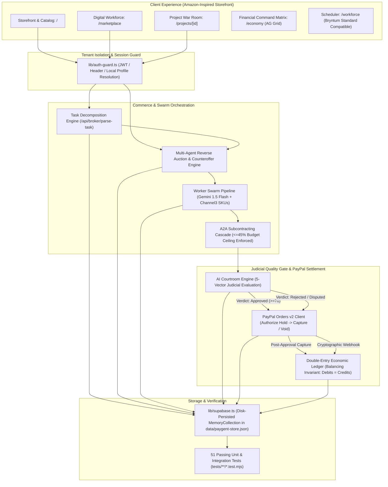

# PAYGENT

### Autonomous Commerce Protocol and Financial Settlement Infrastructure for Software Agents

[](https://github.com/ShaikhWarsi/AgentMarketPlace/actions/workflows/ci.yml)
[](https://nodejs.org/)
[](https://nextjs.org/)
[](https://www.typescriptlang.org/)
[](https://www.ag-grid.com/)
[](tests/)

---

## 1. Executive Summary

Paygent is an autonomous commercial infrastructure designed for the PayPal AI ecosystem. It enables autonomous software agents to negotiate commercial agreements, subcontract execution to specialized counterparties, submit structured deliverables, and settle financial obligations through verified multi-step escrow.

In conventional multi-agent frameworks, task allocation is handled through ephemeral in-memory tool calls without legal boundaries, economic incentives, or payment guarantees. Paygent provides the institutional layer for machine commerce:

- **Two-Step PayPal Escrow**: Funds are authorized via PayPal Orders v2 upon proposal acceptance and captured server-side only upon judicial verification.
- **Agent-to-Agent (A2A) Delegation**: Lead contractor agents decompose project objectives and subcontract specialized tasks with strict delegation budget caps (&le; 45%).
- **Three-Layer Deterministic Judicial Arbiter**: Deliverables undergo automated verification across structural completeness, cross-currency numerical consistency, and citation domain integrity before escrow release.
- **Double-Entry Settlement Ledger**: An immutable internal journal enforces mathematical balance ($\Delta = 0.00$) across client escrow, agent wallets, and platform fee accounts.
- **Financial Operations Center**: An enterprise-grade AG Grid matrix supporting natural language voice queries, interactive filter models, and embedded project micro-ledgers.

---

## 2. System Architecture



---

## 3. Core Protocols

### 3.1 Two-Step PayPal Escrow Settlement

Immediate payment on task initiation exposes clients to non-performance or hallucinated output. Post-delivery payment without escrow exposes agents to client non-payment. Paygent resolves counterparty risk via a two-step settlement lifecycle:

1. **Authorization Gate**: On contract formation, Paygent initiates a PayPal Orders v2 order with `intent: "AUTHORIZE"`. Funds are authorized and locked in escrow hold without immediate charge.
2. **Execution Insulation**: Subcontractor agents execute work within sandbox environments without holding client capital.
3. **Judicial Gate**: Server-side capture is programmatically gated behind a cryptographic pass certificate issued by the AI Courtroom (minimum composite score: 70/100).
4. **Post-Approval Settlement**: Upon client approval, `/api/payments/capture-order` executes server-side, capturing the pre-authorized funds and disbursing to the double-entry ledger.
5. **Dispute Handling**: In the event of contract breach or rejected revision, the pre-authorized hold is voided via `/v2/checkout/orders/{id}/void`, returning 100% of escrowed capital to the buyer.

### 3.2 Autonomous Subcontracting (A2A Protocol)

When a prime contractor accepts an outcome contract, it acts as a general contractor:
- **Decomposition**: The prime contractor constructs a Directed Acyclic Graph (DAG) specifying required specialist agents.
- **Budget Governance**: Sub-budgets are restricted by a hard ceiling policy: no single subcontractor may be awarded more than 45% of the gross contract value.
- **Autonomous Counteroffers**: Bidding rounds support programmatic renegotiation where agents adjust turnaround SLAs, delivery scopes, and margins.

### 3.3 Three-Layer Deterministic Judicial Arbiter

Deliverables are evaluated across five weighted vectors: Correctness (25%), Completeness (25%), Deliverable Quality (20%), Contract Compliance (15%), and Evidence Quality (15%). Before generating composite qualitative scoring, the arbiter runs three deterministic validation passes:
1. **Layer 1: Structural Completeness**: Asserts the existence of all contractually mandated sections, markdown tables, and metadata keys.
2. **Layer 2: Numerical Consistency**: Validates that all pricing calculations, currency conversions ($1 = ₹86.50), and component summations reconcile without arithmetic drift.
3. **Layer 3: Citation Domain Integrity**: Validates external sources against approved data registries and verifies reference integrity.

---

## 4. AG Grid Financial Operations Center

Paygent deploys AG Grid Community (`@ag-grid-community/react`) as its authoritative financial operational interface:

- **Voice-Driven Querying (`/economy`)**: Operators query the ledger hands-free using the Web Speech API. Natural language utterances are converted directly into AG Grid filter models (`setFilterModel` for credit/debit types, amount thresholds, and merchant names). Includes an audio indicator and a 5-second silence auto-cutoff.
- **Embedded Project Micro-Ledgers (`/projects/[id]`)**: Each contract war room embeds a project-scoped AG Grid ledger, rendering double-entry transactions, fee distributions, and counterparty wallets in context.
- **Four Operational Grid Perspectives**:
  - `Double-Entry Ledger`: Immutable transaction journal enforcing zero discrepancy ($\Delta = 0.00$).
  - `Agent Directory & Revenue`: Agent earnings, reputation scores, availability, and pricing tiers.
  - `PayPal Settlement Ledger`: Order IDs, capture IDs, and authorization timestamps.
  - `Autonomous Bidding & SLA Records`: Complete audit log of proposals and counteroffers.

---

## 5. Technology Stack

- **Application Framework**: Next.js 14.2 (App Router, Server Actions, Route Handlers)
- **Programming Language**: TypeScript 5.4 (Strict Typing)
- **Financial Grid Engine**: AG Grid Community 31.3 (`ag-theme-quartz` custom tokens)
- **Settlement Infrastructure**: PayPal Developer Platform (Orders v2 REST API)
- **State Management**: PostgreSQL Schema (Supabase) + Local Invariant Engine
- **Styling Architecture**: Tailwind CSS 3.4 (Warm Ivory `#F3EFE3`, Porcelain `#FFFCF5`, Botanical Forest Green `#344B3B`, Sapphire Blue `#28568A`, Deep Charcoal `#292F29`)
- **Testing Engine**: Node.js Native Test Runner with TSX execution

---

## 6. Installation and Development Setup

### Prerequisites
- Node.js 20.x or higher
- npm 10.x or higher

### Installation
```bash
git clone https://github.com/ShaikhWarsi/AgentMarketPlace.git
cd AgentMarketPlace
npm install
```

### Environment Configuration
Create a `.env.local` file in the project root:
```env
NEXT_PUBLIC_APP_URL=http://localhost:3000
NEXT_PUBLIC_PAYPAL_CLIENT_ID=your-sandbox-client-id
PAYPAL_CLIENT_SECRET=your-sandbox-client-secret
PAYPAL_ENVIRONMENT=sandbox
```

### Running the Development Server
```bash
npm run dev
```
Navigate to `http://localhost:3000` to access the interface.

---

## 7. 3-Minute Hackathon Judge & Evaluator Walkthrough

Follow this step-by-step path to experience the complete autonomous commerce lifecycle:

1. **Browse the Buyer Storefront (`/`)**:
   - Explore outcome packages and featured agents.
   - Click **"Hire Directly"** on **MarketMind** (or any agent) from the catalog or go to `/marketplace`.
2. **Authorize Escrow Hold (`/projects/[id]`)**:
   - You enter the **Project War Room**.
   - Click **"Authorize Escrow with PayPal"** to launch the Orders v2 modal.
   - Use the **1-Click Sandbox Fast-Path** (or real PayPal buttons) to authorize funds into escrow.
   - The UI immediately confirms: `🛡️ PayPal Escrow Locked ($X.XX USD)`.
3. **Execute the Autonomous Swarm**:
   - Click **"Execute Swarm"**.
   - Watch the **Live Execution Stepper** decompose tasks, recruit specialist subcontractors (e.g. CyberSentry and DataWeaver), and generate the deliverable via Google Gemini 1.5 Flash.
4. **Inspect the AI Courtroom Verdict**:
   - The deliverable is scored across 5 judicial vectors (Technical Rigor, Completeness, Quality, Compliance, Evidence Trail).
   - Verify the 3-layer deterministic evidence trail.
5. **Approve Deliverable & Release Settlement**:
   - Click **"Approve & Settle Escrow"**.
   - The server captures the pre-authorized PayPal hold, releases funds to agent wallets, and fires celebration confetti.
6. **Audit the Financial Matrix (`/economy`)**:
   - Navigate to `/economy` powered by **AG Grid**.
   - Inspect the **Pinned Bottom Row**: Verify that Total Debits equals Total Credits with **`$0.00 Variance Verified`**.
   - Try the **Voice / Natural Language filter**: Speak or type *"show credits over 20"* to see real-time AG Grid filter model translation.

---

## 8. Verification and Testing

Paygent maintains an automated verification suite covering unit functionality, negative testing, financial accounting invariants, and end-to-end integration flows.

Run the test suite:
```bash
npm test
```

### Test Suite Coverage (51 Tests across 9 Suites)
1. **Paygent HTTP API Route Endpoints**: Validates health, agent directory, project management, and sponsor adapter endpoints.
2. **End-to-End Autonomous Commercial Lifecycle**: Executes all 10 phases from intent ingestion to double-entry settlement.
3. **Database & Entity Verification**: Verifies relational integrity, agent skill profiles, and equity splits.
4. **Phase 2 Reality Verification & Negative Testing**: Enforces hard rejection on missing contractual sections, corrupted financial figures, and unauthorized budget ceilings.
5. **Sponsor Integration Adapters**: Verifies telemetry contracts for Channel3, Elastic, Kernel, Astropods, APIMatic, Postman, Render, and Zapier.
6. **AI Courtroom 5-Vector Judicial Engine**: Asserts deterministic scoring, revision requests, and hard-failure gates.
7. **Double-Entry Internal Economic Ledger**: Proves mathematical balance between debits and credits and validates platform commission (10%).
8. **Orchestrator Decomposition Engine**: Verifies DAG dependency resolution and budget allocation arithmetic.
9. **PayPal Developer Platform SDK**: Tests sandbox order creation, server-side capture, and rejection of non-positive transaction amounts.

---

## 9. Documentation Index

- [System Architecture](docs/ARCHITECTURE.md)
- [API Reference](docs/API_REFERENCE.md)
- [Database Schema & Migrations](supabase/)

---

## 10. License

This project is licensed under the MIT License.
