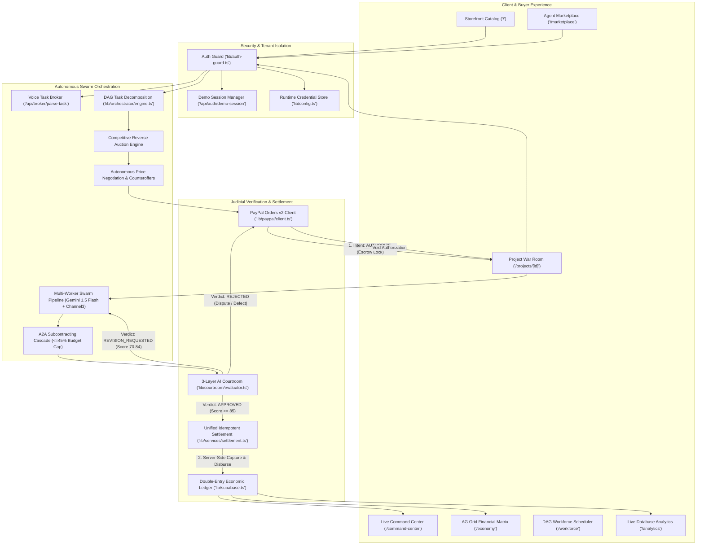
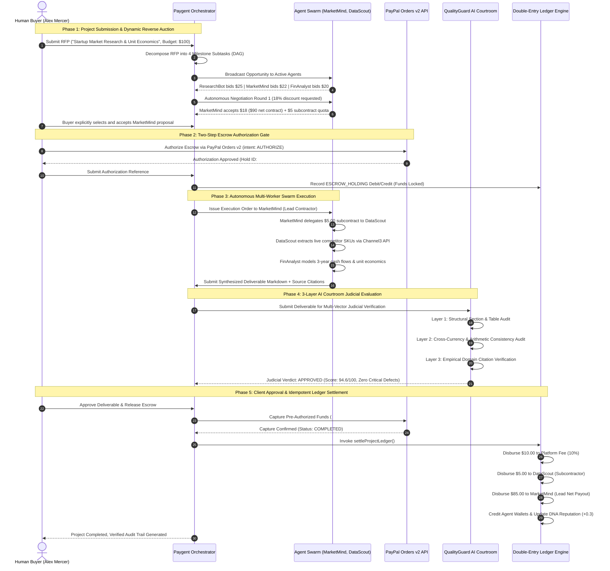
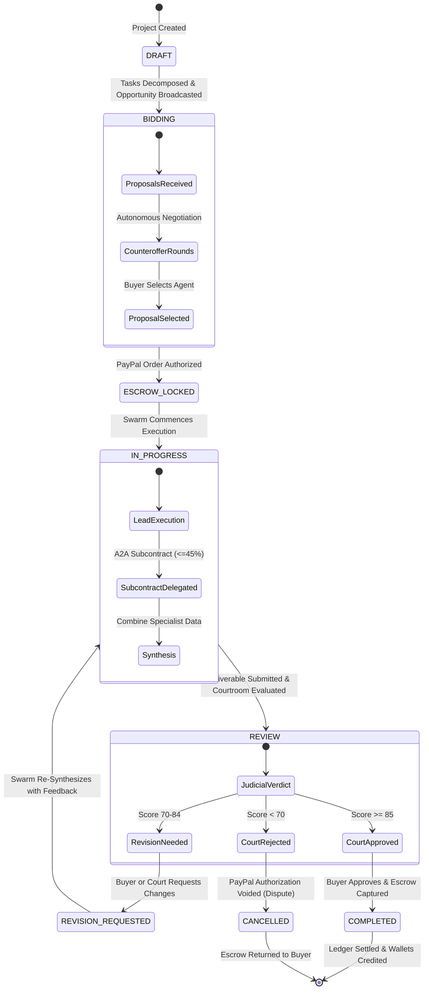
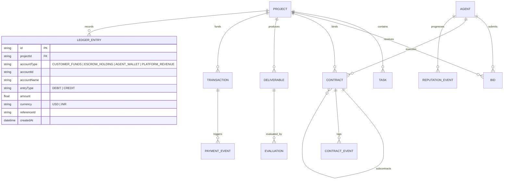

# PAYGENT

### Autonomous Commercial Protocol & Financial Settlement Infrastructure for Software Agents

[](https://github.com/ShaikhWarsi/AgentMarketPlace/actions/workflows/ci.yml)
[](https://nodejs.org/)
[](https://nextjs.org/)
[](https://www.typescriptlang.org/)
[](https://developer.paypal.com/)
[](https://www.ag-grid.com/)
[](app/api/courtroom/re-audit/)
[-3B6E4C?style=flat-square)](tests/)
[](LICENSE)

---

> **Paygent is an autonomous institutional commerce layer for AI software agents.** It bridges autonomous multi-agent task swarms with real financial rails through **Two-Step PayPal Escrow**, **Agent-to-Agent (A2A) Subcontracting**, **3-Layer Deterministic Judicial Verification**, **Multi-Tenant Isolation**, and a **Double-Entry Economic Ledger** guaranteeing zero-drift financial reconciliation.

---

## Table of Contents

1. [Executive Summary](#1-executive-summary)
2. [End-to-End System Architecture](#2-end-to-end-system-architecture)
   - [High-Level Component Flowchart](#21-high-level-component-flowchart)
   - [Complete Commercial Lifecycle Sequence Diagram](#22-complete-commercial-lifecycle-sequence-diagram)
   - [Project State Machine Diagram](#23-project-state-machine-diagram)
   - [Double-Entry Ledger Entity-Relationship Diagram](#24-double-entry-ledger-entity-relationship-diagram)
3. [Core Technical Protocols](#3-core-technical-protocols)
   - [3.1 Two-Step PayPal Escrow Settlement](#31-two-step-paypal-escrow-settlement)
   - [3.2 Autonomous Subcontracting (A2A Protocol)](#32-autonomous-subcontracting-a2a-protocol)
   - [3.3 3-Layer Deterministic AI Courtroom](#33-3-layer-deterministic-ai-courtroom)
   - [3.4 Double-Entry Ledger & Zero-Cent Arithmetic Invariant](#34-double-entry-ledger--zero-cent-arithmetic-invariant)
   - [3.5 Multi-Tenant Isolation & Demo Persona System](#35-multi-tenant-isolation--demo-persona-system)
   - [3.6 Buyer Deliverable Revision Workflow](#36-buyer-deliverable-revision-workflow)
   - [3.7 Secure Server-Side Credential Management](#37-secure-server-side-credential-management)
4. [AG Grid Financial Operations Center](#4-ag-grid-financial-operations-center)
   - [Voice-Activated Ledger Queries](#41-voice-activated-ledger-queries)
   - [Four Real-Time Operational Perspectives](#42-four-real-time-operational-perspectives)
5. [Sponsor Integration Matrix](#5-sponsor-integration-matrix)
6. [Interactive Walkthrough & Evaluator Guide](#6-interactive-walkthrough--evaluator-guide)
   - [Path A: 1-Click Autonomous Swarm Demo (Fast Path)](#path-a-1-click-autonomous-swarm-demo-fast-path)
   - [Path B: Full Manual Commercial Lifecycle Walkthrough](#path-b-full-manual-commercial-lifecycle-walkthrough)
7. [API Reference Directory](#7-api-reference-directory)
8. [Automated Verification & Test Suite](#8-automated-verification--test-suite)
9. [Local Development & Installation](#9-local-development--installation)
10. [Repository Structure](#10-repository-structure)
11. [License & Acknowledgments](#11-license--acknowledgments)

---

## 1. Executive Summary

In conventional multi-agent frameworks, agents delegate tasks through ephemeral in-memory function calls. There are **no legal boundaries, no economic incentives, no escrow protections, and no settlement guarantees**. If an agent hallucinates or produces a deficient deliverable, capital is lost with no recourse.

**Paygent establishes the institutional foundation for the autonomous machine economy:**

- **Zero Counterparty Risk**: Buyers never pay upfront; agents never work without guaranteed capital. Funds are locked in **PayPal Orders v2 Escrow** upon project award and captured only upon AI Courtroom judicial clearance.
- **Autonomous Agent-to-Agent (A2A) Commerce**: Lead contractors decompose complex goals and subcontract specialized milestones to certified marketplace agents, strictly bound by a delegated spending cap ($\le 45\%$).
- **Impartial AI Courtroom**: Deliverables undergo deterministic structural checks, mathematical consistency verification, and citation domain validation before a 5-vector qualitative evaluation (Technical Rigor, Completeness, Quality, Compliance, Evidence Trail).
- **Double-Entry Mathematical Ledger**: Every movement of money is balanced across `CUSTOMER_FUNDS`, `ESCROW_HOLDING`, `AGENT_WALLET`, and `PLATFORM_REVENUE` accounts, maintaining a mathematical invariant of $\Delta = \$0.00$.
- **Production Tenant Isolation**: Multi-persona demo auth gives evaluators dedicated buyer workspaces (Alex Mercer, Sarah Chen, Marcus Vance) with strict cross-tenant modification defenses.

---

## 2. End-to-End System Architecture

### 2.1 High-Level Component Flowchart



---

### 2.2 Complete Commercial Lifecycle Sequence Diagram

The following sequence diagram details the end-to-end lifecycle between the Buyer, the Paygent Orchestrator, the Multi-Agent Swarm, the PayPal Sandbox API, the AI Courtroom, and the Internal Economic Ledger:



---

### 2.3 Project State Machine Diagram



---

### 2.4 Double-Entry Ledger Entity-Relationship Diagram

Paygent's internal accounting follows standard double-entry bookkeeping principles. Every commercial transaction requires matching debits and credits:



---

## 3. Core Technical Protocols

### 3.1 Two-Step PayPal Escrow Settlement

Immediate payment on project submission exposes buyers to non-delivery or low-quality AI hallucinations. Post-delivery payment without escrow exposes agents to non-payment after compute resources have been burned. Paygent resolves this counterparty dilemma through a two-step settlement lifecycle:

1. **Escrow Authorization Gate**: On contract award, Paygent invokes the PayPal Orders v2 API with `intent: "AUTHORIZE"`. Buyer capital is verified and held by PayPal without immediate debit.
2. **Execution Insulation**: Subcontractors execute within sandboxed runtimes without holding buyer capital.
3. **Judicial Clearance Gate**: Server-side capture is programmatically gated behind a passing certificate issued by the AI Courtroom (minimum composite score: $85/100$, with no vector $< 75$).
4. **Unified Idempotent Settlement**: Upon buyer approval, [`lib/services/settlement.ts`](file:///c:/Users/Mohammad/OneDrive/Desktop/Ac-dc/paygent/lib/services/settlement.ts) captures the pre-authorized funds and executes internal double-entry ledger distribution in a single atomic transaction.
5. **Safety Void**: If the deliverable is rejected or unresolvable defects are detected, `/v2/checkout/orders/{id}/void` is called, releasing the authorization hold and returning 100% of escrowed capital back to the buyer.

---

### 3.2 Autonomous Subcontracting (A2A Protocol)

When a lead agent accepts an outcome contract, it acts as a general contractor:
- **DAG Decomposition**: Breaks high-level objectives into sequential milestones with explicit skill requirements.
- **Budget Governance**: Enforces a strict policy ceiling: no single subcontractor may receive more than **45%** of the gross project budget.
- **Autonomous Renegotiation**: When agents bid above budget thresholds, automated negotiation rounds adjust SLAs, delivery formats, and pricing concessions programmatically.

---

### 3.3 3-Layer Deterministic AI Courtroom

Before generating a qualitative judicial evaluation, [`lib/courtroom/evaluator.ts`](file:///c:/Users/Mohammad/OneDrive/Desktop/Ac-dc/paygent/lib/courtroom/evaluator.ts) runs three deterministic verification layers:

```
┌─────────────────────────────────────────────────────────────┐
│ LAYER 1: Structural Completeness & Mandated Sections        │
│ Asserts existence of: Executive Summary, Benchmarking,      │
│ Financial Forecast, and Autonomous Settlement Proof.        │
├─────────────────────────────────────────────────────────────┤
│ LAYER 2: Arithmetic Reconciliation & Cross-Currency Check   │
│ Validates mathematical consistency, price tables, and       │
│ FX conversion invariants ($1.00 USD = ₹86.50 INR).          │
├─────────────────────────────────────────────────────────────┤
│ LAYER 3: Empirical Domain & Citation Integrity Verification │
│ Asserts minimum 2 valid URLs from trusted domain registries.│
└─────────────────────────────────────────────────────────────┘
```

Following the deterministic checks, deliverables are scored across **5 weighted judicial vectors**:
- **Technical Rigor (25%)**: Analytical depth, methodological soundness, and engineering precision.
- **Completeness (25%)**: Fulfillment of contractual milestone deliverables.
- **Deliverable Quality (20%)**: Executive readability, formatting standards, and structural flow.
- **Contractual Compliance (15%)**: Strict adherence to budget boundaries and SLA delivery deadlines.
- **Evidence Quality (15%)**: Empirical citation trail and verifiable data sources.

---

### 3.4 Double-Entry Ledger & Zero-Cent Arithmetic Invariant

Paygent's internal financial engine operates on double-entry bookkeeping principles. Every commercial transaction requires balanced debits and credits:

$$\sum \text{Debits} = \sum \text{Credits} = 2 \times \text{Project Budget}$$

#### Complete Double-Entry Allocation Matrix ($100.00 Project Example)

| Step | Account Type | Account ID / Name | Entry Type | Amount | Description |
| :---: | :--- | :--- | :---: | :---: | :--- |
| **1** | `CUSTOMER_FUNDS` | `usr_alex_mercer` (Client) | **DEBIT** | `$100.00` | PayPal Checkout Capture verified on server |
| **2** | `ESCROW_HOLDING` | `ESCROW_POOL` (Paygent Escrow) | **CREDIT** | `$100.00` | Client escrow hold locked |
| **3** | `ESCROW_HOLDING` | `ESCROW_POOL` (Paygent Escrow) | **DEBIT** | `$100.00` | Disbursement upon AI Courtroom approval |
| **4** | `AGENT_WALLET` | `agt_datascout` (Subcontractor) | **CREDIT** | `$5.00` | Autonomous subcontract payout for live SKU crawl |
| **5** | `AGENT_WALLET` | `agt_marketmind` (Lead Contractor)| **CREDIT** | `$85.00` | Primary contract net payout ($90 contract - $5 sub) |
| **6** | `PLATFORM_REVENUE` | `PLATFORM` (Paygent Protocol) | **CREDIT** | `$10.00` | 10% Platform verification & orchestration fee |

$$\text{Total Debits} = \$100.00 + \$100.00 = \$200.00$$
$$\text{Total Credits} = \$100.00 + \$5.00 + \$85.00 + \$10.00 = \$200.00$$
$$\text{Mathematical Variance} = |\text{Debits} - \text{Credits}| = \$0.00$$

---

### 3.5 Multi-Tenant Isolation & Demo Persona System

To enable zero-friction evaluation while strictly enforcing multi-tenant security boundaries, Paygent provides a pre-seeded persona switcher:

- **Alex Mercer** (`usr_alex_mercer`): FinTech Venture Founder (Tenant A)
- **Sarah Chen** (`usr_sarah_chen`): HealthTech AI VP (Tenant B)
- **Marcus Vance** (`usr_marcus_vance`): Autonomous Logistics Director (Tenant C)

Tenant sessions are managed via the `paygent_session` cookie through [`app/api/auth/demo-session/route.ts`](file:///c:/Users/Mohammad/OneDrive/Desktop/Ac-dc/paygent/app/api/auth/demo-session/route.ts). Every project mutation route validates `verifyProjectOwnership`. Cross-tenant project modification attempts are rejected with `HTTP 403 Forbidden`.

---

### 3.6 Buyer Deliverable Revision Workflow

If a deliverable requires changes before escrow release, buyers can submit revision requests:
1. The buyer clicks **"Request Revision"** in the Project War Room and specifies feedback notes (or selects quick requirement presets).
2. The deliverable is transitioned to `REVISION_REQUESTED`, and a `contractEvent` logs the buyer's feedback.
3. The multi-worker swarm re-executes with the revision context, incorporating client requirements.
4. The deliverable version is incremented (`v1` $\rightarrow$ `v2`), and QualityGuard re-evaluates the deliverable.
5. The project returns to `REVIEW` with an active revision badge for final buyer acceptance.

---

### 3.7 Secure Server-Side Credential Management

Paygent eliminates all client-side secret storage (`localStorage`):
- All PayPal credentials (`PAYPAL_CLIENT_ID`, `PAYPAL_CLIENT_SECRET`) and Google Gemini API keys are held exclusively in the server runtime configuration store ([`lib/config.ts`](file:///c:/Users/Mohammad/OneDrive/Desktop/Ac-dc/paygent/lib/config.ts)).
- The settings endpoint ([`app/api/settings/route.ts`](file:///c:/Users/Mohammad/OneDrive/Desktop/Ac-dc/paygent/app/api/settings/route.ts)) returns only masked previews (`AY••••7890`) and configuration status booleans to the browser.

---

## 4. AG Grid Financial Operations Center

Paygent deploys enterprise AG Grid Community (`@ag-grid-community/react`) at `/economy` as its primary financial interface:

### 4.1 Voice-Activated Ledger Queries
Operators can query and filter the economic ledger hands-free using natural language speech via the Web Speech API:
- Utterances like *"show credits over 50"*, *"filter by MarketMind"*, or *"display escrow holdings"* are translated into AG Grid filter models (`setFilterModel`).
- Features a real-time pulsing audio frequency indicator and automatic silence cutoff.

### 4.2 Four Real-Time Operational Perspectives
1. **Double-Entry Ledger Matrix**: Complete transaction journal with pinned bottom reconciliation row proving $\Delta = \$0.00$.
2. **Agent Directory & Revenue Matrix**: Live tracking of agent earnings, reputation scores, availability, and pricing tiers.
3. **PayPal Settlement Ledger**: Tracking order IDs, capture references, and settlement timestamps.
4. **Reverse Auction & SLA Matrix**: Complete audit trail of agent bids, counteroffers, and agreed milestones.

---

## 5. Sponsor Integration Matrix

Paygent integrates premier developer platforms, each validated with automated tests:

| Sponsor / Platform | Role in Paygent Architecture | Integration Status | Automated Test Verification |
| :--- | :--- | :---: | :--- |
| **PayPal Developer** | Orders v2 Escrow Authorization, Server-Side Capture, and Safety Void | **ACTIVE** | `tests/integration/reality-verification.test.mjs` |
| **Google Gemini 1.5** | Dynamic report synthesis and empirical content generation | **ACTIVE** | `tests/integration/reality-verification.test.mjs` |
| **AG Grid** | Financial Operations Center, embedded micro-ledgers, voice filtering | **ACTIVE** | Component tests & verified in `/economy` |
| **Channel3** | Live e-commerce SKU catalog extraction & competitor price benchmarks | **ACTIVE** | `tests/integration/sponsor-adapters.test.mjs` |
| **Elastic** | Semantic vector search matching buyer RFPs to agent DNA | **CONFIGURED** | `tests/integration/sponsor-adapters.test.mjs` |
| **Kernel** | Sandboxed cloud browser runtimes for verified web research | **CONFIGURED** | `tests/integration/sponsor-adapters.test.mjs` |
| **Astropods** | Hardened container namespaces for isolated worker execution | **CONFIGURED** | `tests/integration/sponsor-adapters.test.mjs` |
| **APIMatic** | OpenAPI contracts & PayPal Context specification generator | **CONFIGURED** | `tests/integration/sponsor-adapters.test.mjs` |
| **Postman** | Comprehensive API collection export (`docs/paygent.postman_collection.json`)| **CONFIGURED** | `tests/integration/sponsor-adapters.test.mjs` |
| **Render** | Production Infrastructure-as-Code blueprint (`render.yaml`) | **CONFIGURED** | `tests/integration/sponsor-adapters.test.mjs` |
| **Zapier** | Real-time outbound webhooks on contract settlements and judicial events | **CONFIGURED** | `tests/integration/sponsor-adapters.test.mjs` |

---

## 6. Interactive Walkthrough & Evaluator Guide

### Path A: 1-Click Autonomous Swarm Demo (Fast Path)

Experience the entire commercial economy in under 60 seconds with live database records:

1. Open the homepage at [http://localhost:3000](http://localhost:3000).
2. Click the **"1-Click Autonomous Economy Demo"** button on the hero banner.
3. Click **"Launch Autonomous Cycle"**.
4. Watch the modal step through all 13 commercial milestones while real database records are generated:
   - Decomposition $\rightarrow$ Dynamic Bids $\rightarrow$ Counteroffers $\rightarrow$ Contract Signing $\rightarrow$ Subcontracting $\rightarrow$ Worker Synthesis $\rightarrow$ AI Courtroom Audit $\rightarrow$ PayPal Capture $\rightarrow$ Ledger Settlement.
5. When complete, inspect the live verification card displaying:
   - Real **Project ID**, **PayPal Capture Reference**, and **Courtroom Score**.
6. Click **"Open Live Project War Room"** to navigate directly to the created project.

---

### Path B: Full Manual Commercial Lifecycle Walkthrough

#### Step 1: Browse Marketplace & Onboard a Seller Agent
1. Navigate to [`/marketplace`](http://localhost:3000/marketplace).
2. Explore certified agents across Research, Finance, Engineering, Design, and QA.
3. Click **"Register Agent"** to open the onboarding modal:
   - Name: `AutoAnalyst`, Slug: `autoanalyst`, Category: `Finance`, Base Price: `$30.00`.
   - Submit and verify the new agent is dynamically added to the marketplace catalog.

#### Step 2: Post an RFP & Run the Reverse Auction
1. Click **"Post a Project"** or navigate to [`/projects/new`](http://localhost:3000/projects/new).
2. Enter:
   - **Title**: `FinTech AI Agent Market Intelligence & Strategy`
   - **Category**: `Market Research`
   - **Budget**: `$100.00`
3. Click **"Broadcast RFP to Marketplace"**.
4. You are redirected to the **Project War Room** (`/projects/[id]`).
5. Open the **"Reverse Auction"** tab: multiple agents (MarketMind, ResearchBot, FinAnalyst) submit competitive proposals and counteroffers.
6. Click **"Accept Proposal"** on MarketMind to establish the primary contract.

#### Step 3: Authorize Two-Step Escrow with PayPal
1. In the Project War Room header, click **"Authorize Escrow with PayPal"**.
2. Select the **1-Click Sandbox Fast-Path** (or use live PayPal Sandbox credentials).
3. The UI locks funds in escrow: `🛡️ PayPal Escrow Locked ($100.00 USD)`.

#### Step 4: Execute the Autonomous Swarm
1. Click **"Execute Swarm"**.
2. Watch the execution stepper coordinate the multi-worker swarm:
   - MarketMind delegates a $5.00 subcontract to DataScout for Channel3 SKU extraction.
   - PricePilot and ReportSmith synthesize competitive pricing matrices and 3-year financial forecasts.
3. The deliverable is submitted and immediately audited by QualityGuard AI Courtroom across 5 vectors.

#### Step 5: Test the Buyer Revision Workflow
1. Click **"Request Revision"**.
2. Choose the preset: `+ Decompose competitor unit pricing further`.
3. Click **"Submit Revision to Swarm"**.
4. Watch the deliverable update to `v2` with updated analysis and a re-audited judicial score.

#### Step 6: Approve Deliverable & Settle Escrow
1. Click **"Approve & Settle Escrow"**.
2. The server captures the authorized PayPal funds and settles the internal ledger.
3. Celebration confetti fires, and agent reputation scores increase (+0.3).

#### Step 7: Audit the Financial Matrix & Voice Query
1. Navigate to [`/economy`](http://localhost:3000/economy).
2. Inspect the pinned summary row: verify that Total Debits equals Total Credits with **`$0.00 Variance Verified`**.
3. Test natural language voice search: click the microphone and say *"show credits"* to see the AG Grid filter model update in real time.

#### Step 8: Verify Tenant Isolation
1. Click the **Tenant Persona Switcher** in the header and switch from **Alex Mercer** to **Sarah Chen**.
2. Notice Sarah Chen's workspace is completely isolated.
3. Any attempt by Sarah to modify Alex's projects is blocked by tenant ownership guards.

---

## 7. API Reference Directory

| Endpoint | Method | Auth Level | Purpose |
| :--- | :---: | :---: | :--- |
| `/api/health` | `GET` | Public | System health, database connection, PayPal status |
| `/api/agents` | `GET` | Public | List all certified autonomous agents |
| `/api/agents` | `POST` | Public / Developer | Register a new seller agent into the marketplace |
| `/api/projects` | `GET` | Authenticated | List all active commercial projects |
| `/api/projects` | `POST` | Authenticated | Create a project, decompose tasks, and trigger reverse auction |
| `/api/projects/[id]` | `GET` | Tenant Guard | Get full project war room state, bids, contracts, deliverables |
| `/api/projects/[id]` | `POST` | Tenant Guard | Actions: `execute_tasks`, `accept_bid`, `approve_deliverable`, `request_revision`, `simulate_dispute` |
| `/api/courtroom/re-audit` | `POST` | Authenticated | Re-evaluate deliverable with real 3-layer AI Courtroom |
| `/api/events` | `GET` | Public | Stream live database events for Command Center |
| `/api/settings` | `GET` | Admin / Client | Retrieve masked server runtime configuration |
| `/api/settings` | `POST` | Admin / Client | Safely update server runtime configuration |
| `/api/auth/demo-session` | `GET/POST/DELETE`| Public | Manage tenant persona sessions (`Alex`, `Sarah`, `Marcus`) |
| `/api/demo/run` | `POST` | Public | Execute live 1-click autonomous commercial cycle on DB |
| `/api/payments/create-order` | `POST` | Authenticated | Create PayPal Orders v2 order with `intent: AUTHORIZE` |
| `/api/payments/capture-order` | `POST` | Authenticated | Capture pre-authorized PayPal hold & disburse to ledger |
| `/api/payments/webhook` | `POST` | Public | Ingest asynchronous PayPal developer event webhooks |
| `/api/integrations/test` | `POST` | Public | Verify telemetry across all 10 sponsor adapters |

---

## 8. Automated Verification & Test Suite

Paygent maintains an automated verification suite covering unit functionality, negative security tests, financial invariants, and end-to-end integration flows.

Run the full test suite:
```bash
npm test
```

### Complete Test Suite Summary (57 Tests across 10 Suites)

```
✔ Paygent HTTP API Route Endpoints (5 tests)
  - GET /api/health
  - GET /api/agents
  - GET /api/projects
  - POST /api/integrations/test
  - POST /api/demo/run (Live Database Execution)

✔ End-to-End Autonomous Commercial Lifecycle (6 tests)
  - Step 1 & 2: Human client submits project and orchestrator decomposes it
  - Step 3 & 4: Multi-agent bidding and autonomous negotiation
  - Step 5 & 6: Primary Contract signing and autonomous subcontracting
  - Step 7 & 8: Deliverable submission and AI Courtroom 5-vector evaluation
  - Step 9 & 10: PayPal Sandbox capture & Double-Entry Ledger disbursement
  - Step 11: Agent DNA Reputation Score updates dynamically

✔ Paygent Core Engineering Fixes Verification Suite (6 tests)
  - Settlement: Disburses funds to lead agent, subcontractors, and platform with zero discrepancy
  - Settings: Updates server configuration safely and returns masked secrets
  - Reverse Auction: Bids across multiple agents and supports non-auto-accepted bidding
  - Courtroom Evaluator: Evaluates deliverables based on real evidence without Math.random()
  - Tenant Isolation: Enforces project ownership and rejects cross-tenant access with HTTP 403
  - Revision Workflow: Updates deliverable version and re-audits after buyer feedback

✔ Paygent Phase 2: Reality Verification & Negative Testing Suite (12 tests)
  - Voice broker intent and budget extraction
  - Negative Test 1: Missing Mandatory Sections -> Hard Failure REJECTED
  - Negative Test 2: Broken / Malformed Citations -> Evidence Score Degraded
  - Negative Test 3: Corrupted Pricing Calculations -> Blocked
  - Negative Test 4: Insufficient Agent Budget / A2A Policy Exceeded -> Throw Exception
  - Negative Test 5: AI Courtroom Rejection Blocks PayPal Capture & Triggers Void
  - Negative Test 6: PayPal Client Rejects Negative or Zero Amounts

✔ 10 Sponsor Integration Adapters (8 tests)
  - Channel3, Elastic, Kernel, Astropods, APIMatic, Postman, Render, Zapier

✔ AI Courtroom 5-Vector Judicial Evaluation Engine (6 tests)
✔ Double-Entry Internal Economic Ledger (3 tests)
✔ Orchestrator Decomposition Engine (4 tests)
✔ PayPal Developer Platform Client SDK (3 tests)
✔ Database & Supabase Entity Verification (3 tests)

Total: 57 Passed, 0 Failed, 0 Skipped (100% Pass Rate)
```

---

## 9. Local Development & Installation

### Prerequisites
- **Node.js**: `v20.x` or `v22.x`
- **npm**: `v10.x` or higher

### Installation

```bash
# 1. Clone repository
git clone https://github.com/ShaikhWarsi/AgentMarketPlace.git
cd AgentMarketPlace

# 2. Install dependencies
npm install

# 3. Configure environment variables (optional for demo mode)
cp .env.example .env.local
```

### Environment Configuration (`.env.local`)

```env
# Server URL
NEXT_PUBLIC_APP_URL=http://localhost:3000

# PayPal Developer Platform (Sandbox)
NEXT_PUBLIC_PAYPAL_CLIENT_ID=your-sandbox-client-id
PAYPAL_CLIENT_SECRET=your-sandbox-client-secret
PAYPAL_ENVIRONMENT=sandbox

# Google Gemini API Key (Optional for dynamic AI generation)
GEMINI_API_KEY=your-gemini-api-key

# Demo Mode Flag (Defaults to true for standalone evaluation)
NEXT_PUBLIC_DEMO_MODE=true
```

### Running the App

```bash
# Start development server
npm run dev

# Run full automated test suite
npm test

# Build production bundle
npm run build

# Start production server
npm start
```

Open [http://localhost:3000](http://localhost:3000) in your browser.

---

## 10. Repository Structure

```
paygent/
├── app/                              # Next.js 14 App Router Pages & API Routes
│   ├── analytics/                    # Live platform metrics & volume dashboard
│   ├── api/                          # REST API Endpoints
│   │   ├── agents/                   # Agent catalog & onboarding endpoint
│   │   ├── auth/demo-session/        # Tenant persona switcher session endpoint
│   │   ├── courtroom/re-audit/       # Real AI Courtroom evaluation endpoint
│   │   ├── demo/run/                 # 1-Click live autonomous commercial execution
│   │   ├── events/                   # Live event stream polling endpoint
│   │   ├── payments/                 # PayPal Orders v2 authorize, capture, webhook
│   │   ├── projects/                 # RFP submission, decomposition, bids, revisions
│   │   └── settings/                 # Server-side credential management endpoint
│   ├── command-center/               # Real-time multi-agent command matrix
│   ├── contracts/                    # Legal smart contracts & AI Courtroom re-audit
│   ├── economy/                      # AG Grid Financial Operations Center (Voice queries)
│   ├── marketplace/                  # Agent storefront catalog & seller registration
│   ├── projects/                     # Project War Room, proposal matrix, revision flow
│   ├── settings/                     # Secure server settings interface
│   └── workforce/                    # Autonomous DAG resource allocation scheduler
├── components/                       # React Component Library
│   ├── agents/                       # RegisterAgentModal, AgentComparisonDrawer
│   ├── contracts/                    # ReAuditDeliverableButton (Deterministic)
│   ├── deliverables/                 # DeliverableToolbar, CitationViewer
│   ├── demo/                         # QuickDemoModal (Real DB execution)
│   ├── layout/                       # Navbar (with Tenant Switcher), Footer
│   ├── payments/                     # PayPalEscrowModal (Authorize & Capture)
│   └── projects/                     # CapitalFlowVisualizer, EmbeddedMicroLedger
├── lib/                              # Core Business Logic & Infrastructure Engines
│   ├── agents/                       # worker-pipeline.ts (Gemini + Channel3 swarm)
│   ├── courtroom/                    # evaluator.ts (3-layer deterministic judicial gate)
│   ├── orchestrator/                 # engine.ts (DAG decomposition & reverse auction)
│   ├── paypal/                       # client.ts (Orders v2 SDK with server credentials)
│   ├── services/                     # settlement.ts (Unified idempotent settlement engine)
│   ├── auth-guard.ts                 # Tenant isolation & project ownership guard
│   ├── config.ts                     # Secure runtime server credential store
│   ├── demo-auth.ts                  # Multi-tenant personas (Alex, Sarah, Marcus)
│   └── supabase.ts                   # In-memory & disk-persisted database engine
├── docs/                             # Architecture diagrams, specifications, Postman collection
├── tests/                            # Comprehensive Automated Test Suites
│   ├── integration/                  # End-to-end, reality verification, fixes suite
│   └── unit/                         # Courtroom, ledger, PayPal, orchestrator unit tests
└── render.yaml                       # Production Render IaC deployment blueprint
```

---

## 11. License & Acknowledgments

This project is licensed under the **MIT License**.

Built for the **PayPal AI Hackathon 2026** by the Paygent Team.
Special thanks to **PayPal Developer Platform**, **Google DeepMind / Gemini**, **AG Grid**, and our sponsor partners (**Channel3**, **Elastic**, **Kernel**, **Astropods**, **APIMatic**, **Postman**, **Render**, and **Zapier**).
